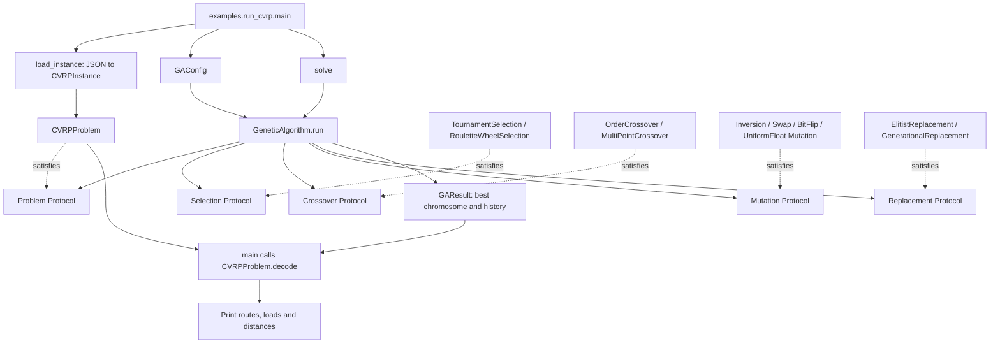
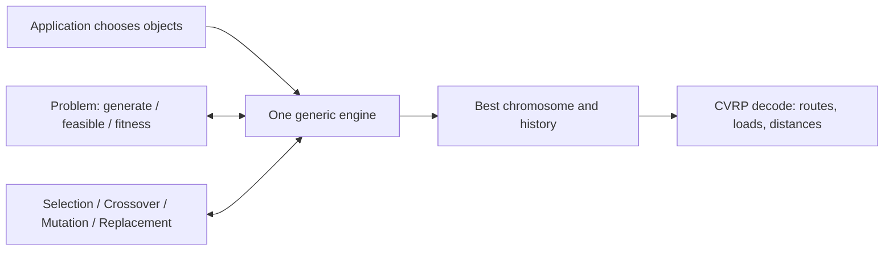

# Understanding Our Genetic Algorithm Toolbox and CVRP Solver

This guide teaches the implementation that is in this repository. It is meant to
be read in order. You need basic Python, but you do not need to know Genetic
Algorithms, design patterns, or vehicle routing already.

The [README](README.md) is the quick guide for running the project. This document
is the longer lesson: what the code means, why its pieces exist, and how a run
moves through them. Paths below are relative to `ga-assignment/`, which is the
project root. The assignment and five lecture PDFs are in its parent directory.

The examples marked **illustrative** use chosen numbers to make a calculation
easy. They are not claims about the random values produced by seed 42. The final
benchmark results come from `data/cvrp/experiments.json`.

Read the parts in order the first time. Later, use this map to return to a topic:

| Part | Teaching focus |
|---|---|
| 1 | GA ideas, architectural choices and the complete dependency diagram |
| 2 | Every project folder, source file, model, method and its connections |
| 3 | The actual engine control flow and its edge cases |
| 4 | All ten genetic strategies with worked examples |
| 5 | CVRP from basic terms to route-splitting DP and measured results |
| 6 | The real command execution path and one illustrative generation |
| 7 | Python features as they appear in this code |
| 8 | Every test method and the bugs it is intended to catch |
| 9 | Design trade-offs and Implementation Notes |
| 10 | 55 TA discussion questions with short explanations |
| Final recap | The Entire Project in One Mental Model |

## Part 1 — The big picture

### 1. What are we trying to build?

Imagine a pickup company with several vans. The vans start at a depot. They must
visit customers, collect items, and return. Each van can carry only a certain
amount. The company wants to drive as little as possible.

There may be many possible visiting orders and many ways to divide customers
between vans. A valid plan is not necessarily a good plan. One plan may obey every
capacity limit but drive a long distance. Another may serve the same customers
with much less travel.

An **optimization problem** asks us to choose the best option according to some
measure, while obeying rules. Here the measure is distance. The rules include
serving every customer once and respecting vehicle capacities. This problem is
called the **Capacitated Vehicle Routing Problem**, or CVRP.

For a large problem, trying every possible order can take too long. Even 16
customers have 16! possible visiting orders: more than 20 trillion. A Genetic
Algorithm, or GA, searches through possible answers without listing all of them.
It keeps a group of answers, gives promising answers more influence, combines
parts of answers, and introduces small changes. It repeats this process many
times.

The assignment asks for two connected pieces. Part 1, worth 60 marks, is a reusable
GA toolbox. Part 2, worth 40 marks, applies that toolbox to CVRP. The supplied PDF
requires three representations, two selection methods, multi-point and order
crossover, at least three mutations, and two replacements. This implementation has
four mutations so that it can also demonstrate real-valued optimization properly.
It uses Python's standard library, rather than a ready-made GA or routing solver.

Why build a toolbox? Because selecting parents, crossing chromosomes and managing
generations are useful beyond routing. Tomorrow we might maximize a binary
function or minimize a real-valued function. We should change the problem and
operator objects, rather than write another evolutionary loop.

### 2. Genetic Algorithms explained as a story

Before routing, consider an easier task: create an eight-bit string with as many
ones as possible. Here `11111111` is best. This is the task of `BinaryProblem` in
`examples/simple_function.py`.

A **gene** is one value in a candidate answer. In `(1, 0, 1, 0)`, each bit is a gene.
We need genes because we want to change or combine parts of answers, rather than
always throwing away an entire answer.

A **chromosome** is the whole encoded answer. That tuple is one chromosome. In
CVRP, a chromosome instead contains customer IDs, such as `(3, 1, 4, 2)`. A gene's
meaning depends on the problem. The engine does not decide that meaning.

An **individual** is a chromosome together with its evaluation. In this code,
`Individual` holds `chromosome`, `fitness`, and `feasible`. We keep the evaluation
beside the chromosome so selection and replacement can compare candidates
without asking the problem to calculate their fitness again.

A **population** is a list of individuals. For example, we could keep four bit
strings instead of one. A group gives the search different starting points and
different pieces to combine. It also reduces dependence on one lucky or unlucky
initial answer. Population members are allowed to have identical chromosomes.

**Fitness** is the number used to judge an answer. For the bit example it is the
number of ones. More is better. For CVRP it is total travel distance. Less is
better. In this repository, fitness often means the raw objective value; the word
does not always mean that a larger number is better.

**Selection** chooses parents from the evaluated population. It matters because
we want better answers to have more influence on future answers. Tournament
selection, for example, chooses two competitors and returns the better one.
Selection is not replacement: choosing a parent does not by itself decide who
survives in the next population.

**Crossover** combines two parent chromosomes into two child chromosomes. It
tries to reuse useful pieces. For example, combining `111|000` and `000|111` can
produce `111|111` and `000|000`. A good child is possible, but so is a bad child.
The algorithm must evaluate the children rather than assume they improved.

A child is also called an **offspring**. Before it is accepted as an Individual,
its chromosome must pass the problem's feasibility check and receive a finite
fitness value.

**Mutation** changes a child. It can introduce a different bit, swap positions, or
move a real-valued gene. Without changes, the search can run out of variety.
Mutation is random, not a promise of improvement. Later selection and replacement
help decide which changes are useful.

**Replacement** builds the next population. Full generational replacement uses
the new children. Elitist replacement considers both old parents and new children
and keeps the best. Replacement matters because there are more candidates than
available population slots.

A **generation** is one round of producing enough accepted offspring and replacing
the population. The initial population is generation 0. The first completed round
is generation 1.

**Termination** is the stopping rule. This engine stops after
`config.max_generations` completed rounds. It does not stop early when progress
slows or when it reaches a known answer. Failure to obtain enough feasible
candidates can raise an error before normal termination.

The process connects like this:

```text
Generate candidates -> check feasibility -> calculate fitness
                                             |
                                             v
                                    select two parents
                                             |
                                             v
                                  cross them or copy them
                                             |
                                             v
                                      mutate children
                                             |
                                             v
                         check feasibility -> calculate fitness
                                             |
                         repeat until enough accepted offspring
                                             |
                                             v
                            record new best; replace population
                                             |
                             repeat for the configured generations
```

Repeating can help because useful parts get more chances to survive and combine.
However, the search can settle around a limited family of answers. Randomness,
operator choice and population size affect the outcome. A GA does not automatically
prove that it found the **global optimum**, meaning the best answer among every
feasible answer.

### 3. Why we designed the architecture this way

We could put every algorithm into `engine.py`:

```python
# An illustration of the design we avoided; this is not repository code.
if selection == "tournament":
    ...
elif selection == "roulette":
    ...
```

That makes the engine responsible both for running the GA and for implementing
each possible selection algorithm. Every new algorithm adds another branch. Tests
for selection become tied to a larger engine. Similar branches would grow for
crossover, mutation and replacement.

Our code instead gives each job a small agreement. A selection object must have a
`select()` method with the expected inputs and output. The engine can call that
method without knowing its algorithm.

This is the **Strategy Pattern**: several objects can perform the same category
of job in different ways, and another object uses one of them. For example,
`RouletteWheelSelection` and `TournamentSelection` are two strategies for selecting
a parent. There are four strategy categories, not a different interface for every
concrete class.

The agreements are **interfaces** written using `typing.Protocol`. A Protocol
lists the required methods and type hints. A concrete class supplies the actual
behavior. `TournamentSelection` does not inherit from `Selection`; it satisfies
the agreement by providing a compatible `select()` method. This is called
**structural typing**: the shape of the object's methods matters.

Protocols are useful descriptions for readers and optional type-checking tools.
They are not automatic runtime guards. Python will not inspect every strategy
at construction and prove that it behaves correctly. This code does not use
`@runtime_checkable` or `isinstance(..., Selection)` checks. Runtime validation
comes from explicit checks in the code, such as rejecting nonfinite fitness.

**Dependency injection** means passing the needed objects into another object.
The engine constructor receives the problem, strategies and configuration. We do
not use a framework for this. Ordinary constructor arguments are enough.

**Composition** means building a larger object by giving it smaller objects.
`GeneticAlgorithm` stores a selection object in `self.selection`. It is not a
subclass of `TournamentSelection`. We choose a combination of objects rather than
create classes such as `TournamentOX1InversionCVRPAlgorithm`.

**Separation of responsibilities** means giving each piece a clear job. The engine
controls **when** selection occurs. The selection strategy decides **how** a
parent is selected. The problem decides what makes a chromosome feasible and what
its fitness is. CVRP route splitting belongs to the routing problem, not to the
engine.

### 4. Complete architecture overview



Solid arrows show a call, a use of data, or a returned result. Dashed arrows say
that an object provides the methods described by a Protocol. They do not mean
explicit Python inheritance.

`main()` first loads the instance. It creates a `CVRPProblem` and a configuration.
Its call to `solve()` creates the concrete strategy objects and passes everything
to the generic engine. The engine stores and calls these objects through the
interfaces. For CVRP the chosen strategies are Tournament, Order, Inversion and
Elitist; the diagram also shows the alternatives available in the toolbox.

`GAResult` contains the best chromosome, fitness and progress information. It does
not contain Route objects. After the search, `main()` asks the CVRP problem to
decode the winning chromosome again, then prints the resulting routes. This is
why a routing-specific output step can exist without putting routing logic in
the generic result model.

## Part 2 — Folder-by-folder, file-by-file explanation

### 1. The real project structure

This is the project's maintained file layout. Root files are shown first, followed
by folders in alphabetical order; files within each folder are also alphabetical. Generated `__pycache__/` folders are omitted because they are Python's
bytecode cache, not source files. The assignment and lecture PDFs live one level
above this tree.

```text
ga-assignment/
├── .gitignore
├── README.md
├── explanation.md
├── pyproject.toml
├── data/
│   └── cvrp/
│       ├── experiments.json
│       └── google_example.json
├── examples/
│   ├── __init__.py
│   ├── run_cvrp.py
│   └── simple_function.py
├── ga/
│   ├── __init__.py
│   ├── config.py
│   ├── engine.py
│   ├── models.py
│   ├── protocols.py
│   └── representations.py
├── operators/
│   ├── __init__.py
│   ├── crossover.py
│   ├── mutation.py
│   ├── replacement.py
│   └── selection.py
├── problems/
│   ├── __init__.py
│   └── cvrp/
│       ├── __init__.py
│       ├── models.py
│       └── problem.py
└── tests/
    ├── __init__.py
    ├── test_cvrp.py
    ├── test_engine.py
    ├── test_operators.py
    └── test_representations.py
```

The following file tour follows this tree. It explains ownership and method
contracts. Parts 3–6 then follow the important algorithms in execution order.

### 2. Root files and the `data/` folder

`.gitignore` lists `__pycache__/`, `*.pyc`, and `.venv/`. It keeps generated Python
files and a local virtual environment out of version control. It has no role in
GA decisions.

`README.md` contains commands, a short architecture description, source decisions,
benchmark results and the grading audit. `explanation.md` is this teaching guide.
Neither Markdown file is read by the application.

`pyproject.toml` declares the project name, version, description, Python requirement
of 3.12 or newer, and an empty dependency list. It does not configure a test
framework, strategy registry or command-line installation script. We run the
modules directly from this directory.

**How these files connect to the rest of the project:** they describe and organize
the project for people and tools. They do not create the engine or provide runtime
configuration values. The actual GA defaults are in `ga/config.py`.

`data/` holds inputs and evidence rather than Python behavior. Its `cvrp/` child
keeps routing-specific data together.

`data/cvrp/google_example.json` has five relevant fields:

| Field | Meaning | Reader |
|---|---|---|
| `depot` | Depot identifier, 0 here | `load_instance()` |
| `customers` | A list of `id` and `demand` objects | `load_instance()` |
| `vehicles` | A list of `id` and `capacity` objects | `load_instance()` |
| `distance_matrix` | 17 rows and columns, in metres | `load_instance()` |
| `source` | The source URL recorded with the data | Human reader; loader ignores it |

The instance has 16 customers and four vehicles of capacity 15. Customer demands
sum to 60. Matrix order is the depot first, then customers in their declared order.
The loader does not fetch the URL or use OR-Tools. The distance values are already
in the local JSON file.

`data/cvrp/experiments.json` is a list of three recorded experiments. Each record
has `config`, `result`, `routes`, and `feasible`. `result.fitness_history` has 501
numbers: the initial best and 500 subsequent best-so-far values. JSON stores tuples
as arrays, so tests convert saved chromosomes back to tuples.

**How these files connect to the rest of the project:** the CLI reads the input
JSON. The saved-experiment test reads the experiment JSON and checks its results.
The CLI does not automatically write experiment records. These files are separate
from the algorithms so input and measured results do not become hardcoded engine
logic.

### 3. The `examples/` folder

This folder contains runnable programs that assemble toolbox components. Choosing
strategies belongs here because the engine itself should not choose them.

`examples/__init__.py` is empty. It marks the directory as a package. It exports
no shortcuts and performs no setup.

**How this file connects to the rest of the project:** it lets module execution
and imports use names such as `examples.run_cvrp`; the useful behavior is in the
two files below.

### 3.1. `examples/run_cvrp.py`

This file is the CVRP application. Without it, the classes could still be used
from Python, but there would be no supplied command that loads and prints CVRP.

Its imports show its assembly role. It imports the generic engine, configuration
and result type, the four chosen concrete strategies, and the CVRP models and
problem. This is the place where both generic and routing-specific components
meet. `argparse` reads command-line options, `json` reads the data, and `Path`
locates it.

`DEFAULT_DATA` uses `Path(__file__).resolve().parents[1]`. Starting from this
source file, it goes to the project directory and then to
`data/cvrp/google_example.json`. The data path does not depend on guessing the
current working directory, although Python still needs to find the project's
packages when launching the module.

`load_instance(path: Path = DEFAULT_DATA) -> CVRPInstance`:

1. Reads the file and turns JSON into Python dictionaries and lists.
2. Creates `Customer(**c)` for every customer dictionary. `**c` supplies its keys
   as named constructor arguments.
3. Creates Vehicle objects in the same way.
4. Converts the customer collection, vehicle collection and each matrix row to
   tuples.
5. Constructs a CVRPInstance. That construction immediately runs its validation.
6. Returns the validated model to `main()` or a test.

It handles this JSON shape only. There is no general CVRP file parser.

`solve(problem: CVRPProblem, config: GAConfig) -> GAResult` constructs
`TournamentSelection(size=2)`, `OrderCrossover()`, `InversionMutation()` and
`ElitistReplacement()`. It passes them and the supplied problem/config to
`GeneticAlgorithm`, calls `.run()`, and returns the result. It contains no
population loop. Its name means “assemble and run,” not “use a second solver.”

`main() -> None` defines the CLI options, parses them and loads one problem. It
then loops over the requested seeds. For each seed, it builds a GAConfig with
minimization set to True, calls `solve()`, decodes the winner and prints it. Options
are `--data`, `--seeds`, `--population`, `--generations`, `--crossover-rate`, and
`--mutation-rate`. `--seeds` accepts one or more integers and defaults to `[42]`.

The print section builds a capacity dictionary keyed by vehicle ID. For each
Route, it prints the customer order between the words `Depot`, its load versus
capacity, and its distance. It sums route distance and load for the totals. It
prints `Feasible: YES` after a successful decode; it does not run another separate
route-validator function at that point. Validity follows from the decoder, and
tests independently inspect its output.

The `try/except` turns ValueError, RuntimeError, OSError, KeyError and TypeError
into a `CVRP error: ...` message and exit code 1. Argument parsing happens before
that block and has argparse's own error reporting. The final
`if __name__ == "__main__": main()` runs the application when invoked as a module,
while importing it in tests does not start a run.

**How this file connects to the rest of the project:** `main()` calls
`load_instance()` and `solve()`. The loader creates CVRP models, `solve()` injects
concrete strategies into the generic engine, and `main()` uses CVRP decoding for
the final display. Tests import the loader and `solve()` directly.

### 3.2. `examples/simple_function.py`

This file proves that the toolbox is useful beyond routing. It imports the same
engine, generic models/configuration, representation helpers and compatible
operators. There are three small dataclasses. Each has a `representation` field
with a default representation object. Those representation objects are frozen,
so sharing a default object does not allow its fields to be edited.

| Problem | Default representation | `fitness()` | Direction in `main()` |
|---|---|---|---|
| `BinaryProblem` | 8 bits | `float(sum(chromosome))` | Maximize |
| `IntegerProblem` | 6 integer genes in [0,9] | Sum of `(i+1)*gene` | Maximize |
| `FloatProblem` | 3 real genes in [-5,5] | Sum of squared genes | Minimize |

For each class, `generate(rng)` delegates to its representation's generator and
returns a chromosome. `feasible(chromosome)` delegates to the representation's
validator and returns a bool. `fitness(chromosome)` calculates the number in the
table. These are the three methods required by Problem, even though none of the
classes explicitly inherits from Problem.

For integer genes `(2, 5, 1)`, the weighted calculation would be
`1*2 + 2*5 + 3*1 = 15`. Moving larger values to later positions can improve it.
The actual default has six genes. Swap alone only rearranges values. Multi-point
crossover can also change which repeated values a child contains by combining
parent segments. This is an ordinary bounded-integer demonstration with an
order-sensitive score, not unrestricted integer search and not a fixed-multiset
sorting problem.

`main()` pairs BinaryProblem with BitFlipMutation, IntegerProblem with
SwapMutation, and FloatProblem with UniformFloatMutation(-5,5). Every run uses
TournamentSelection, MultiPointCrossover, ElitistReplacement, population 30,
60 generations and seed 42. It prints each class name and the complete GAResult,
including the history. The module guard starts `main()` only when run directly.

**How this file connects to the rest of the project:** it implements three Problem
shapes for the same engine. Engine tests import these classes to verify reuse,
reproducibility, feasibility and fitness direction.

### 4. The `ga/` folder

This folder is the reusable core. It defines shared data and agreements, plus the
single evolutionary loop. It must work without importing CVRP or concrete
operators. Representation utilities live here because several problems and
operators use them.

`ga/__init__.py` is empty. It marks `ga` as a package without re-exporting classes.

**How this file connects to the rest of the project:** callers import specific
modules such as `from ga.engine import GeneticAlgorithm`.

### 4.1. `ga/config.py`

`GAConfig` is a dataclass containing the six parameters that control a run:

| Field | Default | Meaning |
|---|---|---|
| `population_size` | 100 | Accepted individuals per population |
| `max_generations` | 500 | Completed reproduction/replacement rounds |
| `crossover_rate` | 0.8 | Probability of crossing one selected parent pair |
| `mutation_rate` | 0.1 | Rate interpreted by the chosen mutation strategy |
| `minimize` | True | Whether smaller fitness wins |
| `seed` | None | Seed for a dedicated random generator |

`__post_init__()` is automatically called after the dataclass constructor stores
these fields. It requires an actual integer population size of at least 2 and an
actual positive integer generation count. It checks both rates are in [0,1],
`minimize` is an actual bool, and `seed` is either None or an actual integer. NaN
rates fail the interval comparison. It does not perform strict numeric-type
checking for the rates; this distinction appears in Implementation Notes.

The class is not frozen. A caller can edit a configuration after constructing it.
The engine calls `__post_init__()` again at the start of `run()` to catch invalid
edits made before a run.

**How this file connects to the rest of the project:** examples construct configs;
the engine reads them; tests supply smaller values and check invalid parameters.
There is no additional configuration manager.

### 4.2. `ga/engine.py`

This file defines `GeneticAlgorithm`. It imports GAConfig, Chromosome, Individual,
GAResult and the five Protocols. Its only other imports are `math` and `random`.
The absence of concrete operator and CVRP imports is central to its reuse.

`__init__(problem, selection, crossover, mutation, replacement, config)` stores
these six supplied objects. It does not start a run or generate candidates.

`_evaluate(chromosome) -> Individual | None` first asks whether the problem says
the chromosome is feasible. If not, it returns None. Otherwise it asks for fitness,
rejects a nonfinite value, and returns an Individual marked feasible. The
underscore says this is an internal helper, not a separate public problem API.

`run() -> GAResult` creates the RNG, fills the initial population, performs the
generation loop, records the best-so-far fitness and constructs the result. Part 3
walks through every stage, including both nested loops and their retry limits.

**How this file connects to the rest of the project:** applications construct it;
it calls Problem and strategy methods; it creates Individual and GAResult objects.
It delegates all problem meaning and operator algorithms to supplied objects.

### 4.3. `ga/models.py`

`Chromosome: TypeAlias = tuple[int | float, ...]` names the common chromosome shape.
The three dots mean the tuple can contain any number of genes. The alias creates
no runtime wrapper and does not enforce gene validity or length.

`Individual` is a mutable dataclass with three fields:

- `chromosome`: the encoded candidate.
- `fitness`: its evaluated objective value.
- `feasible`: whether it is acceptable to the problem.

The engine creates these after successful evaluation. Selection and replacement
read them. In normal engine populations, `feasible` is always True. Keeping the
flag lets the strategies reject manually supplied invalid Individuals too.

`GAResult` is another mutable dataclass:

- `best_chromosome`: the best accepted encoding found during this run.
- `best_fitness`: its objective value.
- `generations`: number of completed generations on successful return.
- `fitness_history`: initial best followed by the best-so-far after each round.
- `best_generation`: generation of the first strict improvement reaching the final
  best fitness; 0 means the initial population already contained that score.

Neither class stores a Route or a CVRPInstance. They are useful for all problems.

**How this file connects to the rest of the project:** these types are the shared
language among interfaces, engine and strategies. Applications interpret the
result according to their own problem.

### 4.4. `ga/protocols.py`

This file imports Protocol, random.Random and the shared chromosome/individual
models. It contains descriptions, not working selection or mutation algorithms.

| Protocol method | Input | Return | Caller |
|---|---|---|---|
| `Problem.generate(rng)` | Shared RNG | A candidate chromosome | Engine initialization |
| `Problem.feasible(chromosome)` | Candidate | bool | `_evaluate()` |
| `Problem.fitness(chromosome)` | Feasible candidate | float | `_evaluate()` |
| `Selection.select(population, minimize, rng)` | Evaluated population and direction | One existing Individual | Engine reproduction |
| `Crossover.cross(parent1, parent2, rng)` | Two chromosomes | Two chromosomes | Engine when crossing occurs |
| `Mutation.mutate(chromosome, rng, mutation_rate)` | One child and rate | One chromosome | Engine for each needed child |
| `Replacement.replace(parents, offspring, population_size, minimize)` | Two evaluated groups, size/direction | Next list of Individuals | Engine once each generation |

The `...` bodies are placeholders expressing the required shape. Selection returns
an Individual because it needs evaluation information. Crossover and mutation
work on chromosome values because their job is to transform encodings. Replacement
returns evaluated Individuals so the next round can select immediately.

**How this file connects to the rest of the project:** the engine depends on these
agreements. Concrete objects match them through their methods. There is no
factory, registry, large inheritance tree or special CVRP interface.

### 4.5. `ga/representations.py`

This file imports Chromosome and uses dataclasses for small representation settings.
It supplies generation and validation, not fitness calculations. Knowing that a
gene is inside a range does not tell us whether a candidate has a good score.

`_length(length)` is an internal guard. It returns normally for an actual positive
integer and raises ValueError otherwise. All three representation classes use it,
directly or through `float_bounds()`.

`float_bounds(length, lower, upper)` accepts scalar bounds or tuples of per-gene
bounds. For length 3, scalars -5 and 5 become three pairs `(-5,5)`. Tuples allow
bounds such as `((0,1), (10,20), (-2,2))`. It checks length, matching counts,
actual numeric types, finite endpoints, lower <= upper, and finite interval width.
Even finite endpoints such as very large opposite-sign values can have an infinite
difference, so width is checked too. It returns a tuple of `(lo, hi)` pairs.

`BinaryRepresentation(length)` is frozen. Its `__post_init__()` checks length.
`generate(rng)` calls `rng.randint(0,1)` once per gene and returns a tuple.
`validate(chromosome)` returns True only for the configured length with actual
integer genes of 0 or 1. It rejects `1.0` and True even though Python compares
these equal to 1.

`IntegerRepresentation(length, lower, upper)` is frozen. Its `__post_init__()`
checks length and ordered integer bounds. `generate(rng)` independently samples
inclusive `randint(lower,upper)` values. Repeats are valid.
`validate(chromosome)` checks length, actual int type and inclusive bounds.
It does not require uniqueness.

`FloatRepresentation(length, lower, upper)` is frozen. Its `__post_init__()` calls
`float_bounds()` to check its settings. `generate(rng)` samples `rng.uniform(lo,hi)`
for each bound pair. `validate(chromosome)` first checks length, then requires
each value to be an int or float, finite, and within its pair. Thus a gene `1` is
accepted as a real value, but True is rejected. NaN and infinity are rejected.
Bounds may be equal, producing a fixed value.

`generate_permutation(ids, rng)` checks that the requested IDs are unique actual
integers, samples all of them without replacement, and returns a tuple. Empty IDs
produce an empty permutation. CVRP instances themselves require customers.

`validate_permutation(chromosome, ids)` checks that the expected IDs are unique
integers, the candidate has the same length, every candidate gene is an actual
integer, and both sets match. These checks together rule out unknown, duplicate
and missing IDs. For example, equal sets alone would not reject `(1,2,2)` against
`(1,2)`, but the length check does.

**How this file connects to the rest of the project:** toy problems use the three
representation classes. CVRP uses the permutation functions. OX1 validates its
parents with the permutation validator, and bit/float mutation uses the matching
validators. The engine does not import these helpers; its Problem supplies the
appropriate feasibility behavior.

### 5. The `operators/` folder

This folder holds the interchangeable algorithms. It depends on generic models
and, where needed, representation validators. It does not import CVRP. Keeping
these algorithms outside the engine lets us test and replace them separately.

`operators/__init__.py` is empty and marks the package.

**How this file connects to the rest of the project:** examples import individual
operator modules. The empty initializer makes no strategy choices.

### 5.1. `operators/crossover.py`

This file imports Chromosome and `validate_permutation()`. That second dependency
exists because OX1 must reject unsuitable parents before it starts filling a child.

`MultiPointCrossover` is a frozen dataclass with `points=2`.
`__post_init__()` requires an actual positive integer point count. Its
`cross(parent1, parent2, rng)` checks equal lengths and enough internal boundaries,
samples the boundaries, alternates parent slices and returns two tuples.

`OrderCrossover.cross(parent1, parent2, rng)` validates matching integer
permutations, handles lengths below 2, samples two inclusive gene positions, and
creates two children. Its nested `child(a,b)` helper copies a segment from a and
fills the other positions using the cyclic order from b. The same helper is called
with the parent roles reversed. It is local because nothing outside this operation
needs it. Part 4 works through the exact loops for both algorithms.

**How this file connects to the rest of the project:** the engine calls `cross()`
only when its crossover probability condition passes. CVRP selects OrderCrossover;
the three toy examples select MultiPointCrossover. Crossover returns unevaluated
chromosomes, which still pass through mutation and `_evaluate()`.

### 5.2. `operators/mutation.py`

This file imports Chromosome, the binary/float validators, and `float_bounds()`.
It owns all mutation probability decisions.

`_rate(rate)` raises ValueError unless the rate lies in [0,1]. `_occurs(rng,rate)`
returns `rate > 0 and rng.random() <= rate`. The zero guard means a controlled
random draw of exactly zero cannot cause a rate-zero mutation. Short-circuit
execution also means rate zero does not consume a probability draw here.

`BitFlipMutation.mutate(chromosome, rng, mutation_rate)` checks a nonempty binary
chromosome and performs one independent probability check per bit.

`SwapMutation.mutate(...)` makes a list copy, performs one probability check for
the whole chromosome, and swaps two sampled distinct positions when possible.

`InversionMutation.mutate(...)` has the same whole-chromosome gate, but reverses
the inclusive segment between the sampled positions.

`UniformFloatMutation` is a frozen dataclass holding `lower` and `upper`. Its
`mutate(...)` validates the rate, bounds and input values, then checks each gene
independently. If selected, the gene moves left or right by a random displacement
that fits its remaining interval. Bounds are validated when the method is used,
not by a `__post_init__()` on this strategy. Part 4 explains every random draw.

**How this file connects to the rest of the project:** the engine calls the chosen
`mutate()` once for every child it still needs. It passes the rate through unchanged
and applies no second mutation gate. Toy examples select compatible mutations;
CVRP selects inversion. All return tuples for subsequent evaluation.

### 5.3. `operators/replacement.py`

This file imports Individual and `math.isfinite`. It works with already evaluated
candidates and uses no RNG.

`_check(candidates,size)` requires a positive requested size, enough candidates,
feasible flags and finite fitness values. It checks the entire supplied candidate
list, even candidates that might be cut off later.

`GenerationalReplacement.replace(parents, offspring, population_size, minimize)`
validates offspring and returns `offspring[:population_size]`. The parameters
`parents` and `minimize` are unused by this policy, but remain in its common
interface.

`ElitistReplacement.replace(...)` joins parents and offspring, validates them,
sorts by fitness in the appropriate direction, and takes the first requested
number. Equal-fitness candidates keep Python's stable input order, so parents
precede offspring on a tie because the combined list is `parents + offspring`.

**How this file connects to the rest of the project:** the engine calls replacement
once after filling a generation's offspring. The result becomes the next population.
Both CVRP and the toy example runner choose ElitistReplacement. Tests also inject
GenerationalReplacement to demonstrate why the engine needs a separate best record.

### 5.4. `operators/selection.py`

This file imports Individual, Random and dataclass. It compares fitness values,
not gene values.

`_validate(population)` rejects an empty population, infeasible flags or nonfinite
fitness. It does not call `problem.feasible()` again; it checks stored evaluations.

`RouletteWheelSelection.select(population,minimize,rng)` creates safe nonnegative
weights, chooses uniformly for equal/zero weights, otherwise draws a position in
the weight total and returns the Individual whose cumulative interval contains it.
The last positive-weight fallback handles floating-point accumulation edges.

`TournamentSelection` is a frozen dataclass with `size=2`.
`__post_init__()` requires an actual integer size of at least 2.
`select(...)` validates the population and ensures the size does not exceed it,
samples distinct entries and returns the minimum- or maximum-fitness contestant.

**How this file connects to the rest of the project:** the engine calls selection
twice per parent pair. Returning an existing Individual lets the engine obtain
its chromosome without reevaluation. All supplied example runs choose tournament;
roulette is supplied and tested as the second selectable strategy.

### 6. The `problems/` and `problems/cvrp/` folders

`problems/` is the place for meanings specific to an optimization task. Its `cvrp/`
child owns routing data and interpretation. A future different problem could live
beside CVRP without changing the toolbox.

`problems/__init__.py` and `problems/cvrp/__init__.py` are both empty package markers.

**How these files connect to the rest of the project:** they enable imports such
as `problems.cvrp.problem`; neither constructs a problem or imports the engine.

### 6.1. `problems/cvrp/models.py`

This file imports dataclass and math. It has no dependency on the GA engine or
strategies because routing input models can exist independently of a GA.

All four classes use `frozen=True`:

| Model | Fields | Meaning and creation |
|---|---|---|
| `Customer` | `id`, `demand` | One required visit and quantity; created by loader or tests |
| `Vehicle` | `id`, `capacity` | One available vehicle; created by loader or tests |
| `Route` | `vehicle_id`, `customers`, `load`, `distance` | One decoded vehicle trip; created in `decode()` |
| `CVRPInstance` | `depot`, `customers`, `vehicles`, `distance_matrix` | Complete routing input; created by loader or tests |

A Route's `customers` tuple excludes the depot. The decoder includes departure
and return in `distance`; the CLI displays the depot at both ends. Vehicle IDs
are identifiers, not necessarily zero-based array positions.

`CVRPInstance.__post_init__()` validates the input after construction:

1. Builds the location ID list from the depot followed by the customers, and a
   separate vehicle ID list.
2. Requires actual integer IDs and unique entries within each list. The depot
   cannot also be a customer. A vehicle ID may equal a customer ID because they
   identify different types of object.
3. Requires at least one customer and vehicle.
4. Requires finite positive capacities and finite nonnegative demands.
5. Requires a square matrix with one row and column per location.
6. Requires finite, nonnegative distances.
7. Rejects a customer that exceeds every vehicle's capacity.
8. Rejects total demand above total fleet capacity.

It does not require a symmetric matrix or zero diagonal. Different costs in
opposite directions are supported. It does not prove that all items can be packed
into vehicles; passing necessary checks is weaker than finding an assignment.
Customer and Vehicle individually have no validation methods; the enclosing
instance validates their values.

**How this file connects to the rest of the project:** the loader builds the input
models; CVRPProblem reads them and constructs Route outputs. The CLI and tests
inspect Route fields. These models contain no evolutionary behavior.

### 6.2. `problems/cvrp/problem.py`

This file imports generic Chromosome and permutation helpers, plus CVRPInstance
and Route. It does not import GeneticAlgorithm. The problem is usable even when
we simply want to decode and score an order manually.

`CVRPProblem.__init__(instance)` stores the instance and builds three lookup
structures:

- `ids`: customer IDs in declared order, used for generation and validation.
- `demands`: dictionary from customer ID to demand.
- `indices`: dictionary from location ID to matrix position, with the depot mapped
  to position 0.

The mappings avoid confusing a customer ID with a matrix row. Depot 99 and
customers 7 and -2 are valid IDs, for example, while their matrix positions are
still 0, 1 and 2.

`generate(rng) -> Chromosome` returns `generate_permutation(self.ids,rng)`. It does
not test route feasibility before returning. The engine calls `feasible()` after
it generates each candidate.

`decode(chromosome) -> list[Route] | None` is the main routing algorithm. It checks
the permutation, precomputes segment loads and costs, builds a table of cheapest
feasible prefixes by vehicle, then reconstructs the chosen routes. None means no
assignment exists under its contiguous, vehicle-ordered decoder model. Part 5
explains this algorithm with a complete four-customer example.

`feasible(chromosome) -> bool` calls `decode()` and checks whether the answer is
not None. It does not contain separate loops repeating every coverage and capacity
check. Those properties follow from the validated permutation and the route-split
construction.

`fitness(chromosome) -> float` independently calls `decode()` again. It raises
ValueError if decoding fails; otherwise it sums Route distances. Thus a feasible
candidate is normally decoded twice inside `_evaluate()`. The implementation
chooses simple repeated computation over a cache.

**How this file connects to the rest of the project:** it supplies the three
Problem methods called by the generic engine. It additionally exposes `decode()`
for CVRP display and tests. Selection/crossover/mutation do not calculate routes;
CVRPProblem does so when a chromosome is evaluated.

### 7. The `tests/` folder

Tests live outside application modules so checking behavior does not become part
of normal GA execution. They use unittest and unittest.mock from the standard
library. `tests/__init__.py` is an empty marker.

**How this file connects to the rest of the project:** it makes the test directory
importable; discovery finds the test files and unittest invokes their methods.

`tests/test_cvrp.py` defines `small()` for creating tiny line-distance instances
and `CVRPTests.assert_routes()` for independently checking a decoded result. Its
CVRPTests class contains ten tests for manual costs, optimal splitting, capacities,
coverage, invalid input, heterogeneous fleet behavior, seeded execution and saved
experiments. It imports the application's loader and `solve()` to exercise the
actual integration path.

**How this file connects to the rest of the project:** it compares CVRP outputs
against independent calculations and uses the same generic engine through the
example's assembly function. Part 8 lists every test by name and purpose.

`tests/test_engine.py` defines an `engine(problem=None, **kwargs)` test helper. It
creates convenient default engine arguments, then overrides them with supplied
keyword values. EngineTests contains seven tests. It imports the three toy
problems, real operators and Mock, allowing it to test reuse and observe exact
calls without adding observation features to the engine.

**How this file connects to the rest of the project:** it exercises the generic
loop independently of CVRP, including rejected children, retry errors, injected
strategies and retained best solutions. It creates no additional engine class.

`tests/test_operators.py` defines `population(*values)`, which turns a sequence of
fitness numbers into Individuals with simple index chromosomes. SelectionTests,
CrossoverTests, MutationTests and ReplacementTests group twelve operator tests.
Mock supplies known samples or draws and can count calls.

**How this file connects to the rest of the project:** it calls real operator
methods directly so an incorrect crossover or mutation cannot hide behind a lucky
end-to-end result. Part 8 explains their mathematical checks.

`tests/test_representations.py` has RepresentationTests and five tests for
generation, validation, bounds, invalid configurations and permutations. It uses
seeded Random objects for real generators.

**How this file connects to the rest of the project:** it checks the utilities
used by toy problems, CVRP and mutation/crossover. It does not run the engine;
engine reuse is tested separately.

## Part 3 — Deep explanation of the GA engine

### 1. Constructing the engine does not run it

The real constructor signature is:

```python
def __init__(self, problem: Problem, selection: Selection, crossover: Crossover,
             mutation: Mutation, replacement: Replacement, config: GAConfig) -> None:
```

Each argument becomes an attribute with the same name. There is no hidden choice
of tournament size, crossover style or routing behavior. The calling application
chooses concrete objects. The constructor itself performs no configuration
validation; GAConfig validated itself when created, and `run()` validates it again.

For example, injecting GenerationalReplacement instead of ElitistReplacement
changes survivor behavior without changing the engine. The responsibility for
choosing compatible operators stays with the caller. The engine does not have a
registry that knows OX1 requires permutations.

### 2. The evaluation doorway: `_evaluate()`

All initial and child candidates go through the same helper:

```python
if not self.problem.feasible(chromosome):
    return None
fitness = self.problem.fitness(chromosome)
if not math.isfinite(fitness):
    raise ValueError("Problem returned nonfinite fitness")
return Individual(chromosome, fitness, True)
```

First comes feasibility. This prevents an invalid customer order from receiving
an attractive score by accident. Returning None means “reject this candidate and
try another.” It is different from a fitness of zero, which can be a perfectly
valid objective value.

A feasible candidate then receives fitness. NaN is “not a number”; infinity is
not a usable finite objective. Both raise an error rather than become selection
weights or comparison results. An exception raised by the problem or a strategy
also propagates; the engine does not broadly catch errors and disguise them as
ordinary rejections.

The engine trusts the problem's meaning of feasibility. For CVRP, the decoder
establishes it. For a toy binary problem, the representation validator establishes
it. The engine does not independently understand either.

### 3. Starting `run()`: settings and randomness

`run()` revalidates the mutable configuration, then creates:

```python
rng = random.Random(self.config.seed)
size = self.config.population_size
limit = 1000 * size
```

This Random instance is local to the run. Every generator, selector, crossover
and mutation receives the same object. They consume random values in execution
order. There is no use of global `random.seed()`.

With the same seed, code, inputs and environment, rerunning starts the same random
sequence and follows the same decisions. Calling `run()` twice on the same supplied
stateless strategies recreates the RNG and is reproducible in tests. A custom
stateful problem or strategy could break that assumption. Changing the population
size or an operator also changes which draws are consumed, so the same seed does
not promise identical results after changing the algorithm.

The retry limit is fixed internally, not another GAConfig field. For population
100 it is 100,000 attempts per initialization phase and per generation.

### 4. Filling the initial population

The engine starts with `population = []`. On each attempt it:

1. Calls `problem.generate(rng)` for a candidate.
2. Calls `_evaluate()`.
3. Appends the returned Individual only when it is not None.
4. Breaks as soon as the list reaches `size`.

For CVRP the generated tuple is a random permutation; for BinaryProblem it is a
random bit tuple. The engine's code is identical for both.

The loop is a Python `for ... else`. Its `else` executes only when the loop runs
out of attempts without a `break`. It then raises
`RuntimeError("Initialization retry limit reached: cannot fill a feasible population")`.
The loop cannot keep sampling forever. It also does not fill remaining slots with
invalid answers or silently switch to another search technique.

Attempts are counted for the whole phase, not reset after each accepted candidate.
Duplicate chromosomes are allowed. The algorithm requires the configured number
of feasible individuals, not that many distinct encodings.

### 5. Establishing the initial best

The engine chooses the comparison function once:

```python
choose = min if self.config.minimize else max
best = choose(population, key=lambda x: x.fitness)
history = [best.fitness]
best_generation = 0
```

For CVRP, `minimize=True`, so shorter distance wins. For counting ones,
`minimize=False`, so a larger count wins. The `key` means compare the fitness
attribute rather than attempting to compare the Individual objects themselves.

The initial history entry is recorded before any children are created. If the
initial population already contains the best answer found in the run,
`best_generation` will remain 0.

### 6. Beginning each generation

`range(1, max_generations + 1)` includes generations 1 through the configured
maximum. A new empty `offspring` list is created at the start of each round.
Parents are always selected from the current population. Earlier children in the
same generation do not become parents until replacement finishes.

The reproduction loop allows up to `limit` parent-pair attempts. One attempt can
produce zero, one or two accepted children. This is different from the initialization
loop, where one attempt generates one candidate.

### 7. Selecting two parents

The engine calls:

```python
p1 = self.selection.select(population, self.config.minimize, rng)
p2 = self.selection.select(population, self.config.minimize, rng)
```

Both selections use the same population. These are separate calls, so p1 and p2
can be the same Individual. Tournament sampling chooses distinct competitors
within one tournament; it does not require two different winning parents across
the two tournaments.

The engine reads their chromosomes. It does not recalculate parent fitness:
Individuals already carry it.

### 8. Crossing or copying the parents

One random draw is made per selected pair:

```python
draw = rng.random()
if self.config.crossover_rate > 0 and draw <= self.config.crossover_rate:
    children = self.crossover.cross(p1.chromosome, p2.chromosome, rng)
else:
    children = (tuple(p1.chromosome), tuple(p2.chromosome))
```

With crossover rate 0.8, an illustrative draw 0.6 triggers crossing; 0.9 does not.
Rate 0 always skips crossing. Rate 1 always crosses with a normal Random object,
whose `random()` values lie in [0,1). The explicit zero guard also handles a
controlled RNG draw of exactly zero correctly.

Skipping crossover does not skip mutation. The copied parent chromosomes still
enter the child loop. Because tuples are immutable, `tuple(existing_tuple)` may
return the same object safely; no editable parent list is shared.

### 9. Mutating and accepting children

For each child the engine still needs:

1. Calls `mutation.mutate(chromosome,rng,mutation_rate)` exactly once.
2. Evaluates the returned chromosome through `_evaluate()`.
3. Appends it only if feasible with finite fitness.
4. Stops processing children immediately once `len(offspring) == size`.

The mutation strategy decides whether a value changes. Even a rate-zero strategy
call matters because its contract returns the chromosome to evaluate. The engine
must not add another mutation check; doing so would accidentally reduce effective
mutation probabilities.

If one child is rejected, the other child can still be accepted. The next pair
is produced normally. There is no repair operation, random immigrant fallback,
or “retry only this exact child” mechanism.

For population size 7, three fully accepted pairs provide six children. The first
accepted child of the next pair fills slot seven. The engine breaks before
mutating or evaluating the second child. Crossover may already have constructed
both chromosome tuples, but the unused tuple does not enter the population.
If the first child of that pair is rejected, the second may fill the last slot.

If the generation cannot collect enough accepted offspring before its attempt
limit, it raises `RuntimeError` naming the generation. It does not return a partial
GAResult in this case.

### 10. Updating the best before replacement

After filling the offspring list:

```python
candidate = choose(offspring + [best], key=lambda x: x.fitness)
if candidate.fitness != best.fitness:
    best, best_generation = candidate, generation
```

Including the old best means this comparison cannot choose a worse score. If the
chosen candidate has the same score, the stored best is not changed. Therefore
an equal-fitness child does not overwrite the earliest recorded best generation.

Why update before replacement? A custom replacement could discard a useful child.
The engine records every new best among accepted children before deciding survivors.
The initial best plus every generation's children already cover all newly created
candidates under the supplied replacement policies.

### 11. Replacing the population

The engine calls the injected replacement with parents, accepted offspring,
requested size and fitness direction. It checks that the returned list has exactly
the requested length, all flags are feasible, and all fitnesses are finite.
A violation raises ValueError.

This is a useful contract check, not a full defense against arbitrary strategies.
It does not decode returned chromosomes again, recalculate their scores, or check
that returned Individuals actually came from the supplied lists. Our two concrete
replacement policies do satisfy that intended contract.

With generational replacement, the next population can be worse than the previous
one. Suppose minimization had best 8 and all new children have costs 10 or more.
The next population's best might be 10, but the separate best record stays 8.
With elitist replacement, an 8-cost parent competes with the children and survives
unless enough equally good or better candidates take its place.

### 12. Recording progress and returning

After replacement succeeds, `history.append(best.fitness)` records the best-ever
score. The history is nonincreasing for minimization and nondecreasing for
maximization. It is not the average fitness or necessarily the current population's
best under a nonelitist policy.

After the final round, the engine constructs:

```python
GAResult(best.chromosome, best.fitness, self.config.max_generations,
         history, best_generation)
```

A successful default run has `generations=500` and 501 history values. There is no
early stopping, progress callback, final-population field, timing field or routing
field. The application uses this small result to present its own meaningful output.

## Part 4 — Every genetic operator, explained

Selection and replacement compare evaluated Individuals. Crossover and mutation
transform chromosomes. Keep that difference in mind while following the examples.
All random values in the worked examples below are illustrative unless identified
as a test case.

### 1. Roulette Wheel Selection

**What and why.** Imagine a wheel split into slices. Better candidates receive
larger slices, so a random spin is more likely to select them. This keeps a chance
for several candidates rather than always choosing the single best. The algorithm
comes from Lecture 4 and works with any encoding that has usable fitness values.

**Steps in `RouletteWheelSelection.select()`:**

1. `_validate()` checks the stored evaluations.
2. Collect the fitness values.
3. Divide by the largest absolute value, or by 1 if all are zero. A common factor
   preserves proportions and avoids overflow when summing large values.
4. For minimization, subtract each normalized cost from the largest normalized
   cost. For maximization, subtract the normalized minimum only if it is negative.
5. Sum the weights. If all values are equal or total weight is zero, use
   `rng.choice(population)` instead.
6. Draw `target = rng.random() * total`.
7. Accumulate weights in population order. Return the first Individual for which
   `target < cumulative`.
8. If rounding prevents an earlier return, return the last positive-weight entry.

For nonnegative maximization fitness `(1,2,7)`, the proportions are 10%, 20%, 70%.
Conceptually, using total 10, the intervals are:

| Individual | Weight | Interval |
|---|---:|---|
| A | 1 | [0,1) |
| B | 2 | [1,3) |
| C | 7 | [3,10) |

A normalized random draw 0.25 corresponds to 2.5 on this conceptual wheel, so B
wins. The code's normalization by 7 changes both weights and total by the same
factor; it still selects B. A draw exactly on the boundary after A belongs to B
because the condition uses `<`, not `<=`.

For minimization costs `(10,20,30)`, the unnormalized equivalent weights are
`(20,10,0)`. A is most likely and C has no chance in that selection. For negative
maximization values `(-3,-1,0)`, shifting produces `(0,2,3)`. If all values are 5,
or all are 0, or all are -3, selection is uniform. No division by a zero total is
needed.

**Code detail.** The generator expression in the fallback finds indices with
positive weights; `max(...)` selects the last index, not the greatest fitness.
This is a rounding fallback, not another selection policy.

**Use and limits.** The method is representation-independent, but its behavior
can be sensitive to fitness scaling and outliers. Our minimization transformation
is simple and population-dependent; adding an unrelated candidate can change the
weights. It is not a universal scaling framework. CVRP therefore uses tournament
selection instead. Roulette does not rescore chromosomes or prove feasibility;
it trusts finite stored evaluations after checking their flags.

### 2. Tournament Selection

**What and why.** Choose a few candidates, let them compete, and return the one
with better fitness. Pairwise competition is the Lecture 4 version and the default
here. It is convenient for minimization because it can compare distances directly.

**Steps in `TournamentSelection.select()`:**

1. Validate the stored population.
2. Reject a requested tournament size above its length.
3. Run `rng.sample(population,self.size)`.
4. Use min for minimization or max for maximization, with fitness as the key.
5. Return that existing Individual.

Suppose costs are A=4, B=1, C=8. If the sampled competitors are A and C,
minimization chooses A, even though B is the best in the whole population. B did
not enter this tournament. Maximization with the same competitors chooses C.
The tests control those exact competitors.

`rng.sample()` chooses distinct population positions within one tournament.
Repeated chromosomes or even repeated object references in different positions
are still possible in a population. Each new tournament samples again. Fitness
ties return the first sampled entry because min/max keep the first equal key.

**Use and limits.** Any representation can use it. Larger tournaments make good
candidates harder to beat, increasing selection pressure: the tendency to favor
better candidates. Too much pressure can remove variety quickly. Size must be at
least 2 and no larger than the population. Selecting twice does not guarantee
different winning parents.

### 3. Multi-Point Crossover

**What and why.** Cut two equal-length chromosomes at several shared boundaries.
Alternate which parent's segments go into each child. Lecture 4 presents this as
a generalization of single-point crossover.

**Steps in `MultiPointCrossover.cross()`:**

1. Check equal lengths and length greater than `self.points`.
2. Sample distinct internal cuts from `range(1,len(parent1))`.
3. Sort the cuts and add 0 and the full length as outer boundaries.
4. Visit each adjacent boundary pair `(start,end)`.
5. For an even segment index, child 1 receives parent 1's slice and child 2
   parent 2's. For an odd segment index, exchange the sources.
6. Return tuples built from the two temporary lists.

For length 7 and cuts 2 and 5:

```text
Parent 1: 00 | 000 | 00
Parent 2: 11 | 111 | 11
Child 1:  00 | 111 | 00
Child 2:  11 | 000 | 11
```

The actual construction of boundaries is:

```python
cuts = [0] + sorted(rng.sample(range(1, len(parent1)), self.points)) + [len(parent1)]
```

For those draws it becomes `[0,2,5,7]`. `zip(cuts,cuts[1:])` gives `(0,2)`,
`(2,5)`, `(5,7)`. Slices exclude their end, so these cover all genes once without
overlap. `i % 2` chooses the alternating source parents. `.extend()` adds all
genes of a slice to a child list, rather than nesting the slice as one element.

**Use and limits.** Binary, ordinary integer and real tuples are suitable when
swapping same-position segments respects their problem constraints. The method
does not validate binary or floating values itself. It only validates lengths
and point count. Problems still check the final chromosomes.

Ordinary multi-point crossover can break permutations:

```text
Parent 1: 1 2 | 3 4
Parent 2: 3 4 | 1 2
Child 1:  1 2 | 1 2   <- repeated 1 and 2, missing 3 and 4
```

There is no repair in this implementation, so CVRP must choose OX1 instead. Default
points=2 requires at least three genes. Invalid length settings raise ValueError;
the method does not silently reduce the requested point count.

### 4. Order-1 Crossover, or OX1

**What and why.** A permutation needs every value exactly once. OX1 preserves a
segment of one parent and fills remaining positions in the other parent's order,
skipping already used values. This combines useful ordering information without
creating missing or repeated customers. It is the Lecture 4 order algorithm.

**Steps in `OrderCrossover.cross()`:**

1. Validate that parent 1 is an integer permutation and parent 2 uses exactly its
   same genes once each.
2. Return unchanged tuples for length 0 or 1.
3. Sample two different gene positions; sort them into left and right.
4. In `child(a,b)`, preserve `a[left:right+1]`.
5. Set the next write position to `(right+1) % length`.
6. Read b cyclically, also starting at `(right+1) % length`.
7. Skip a read gene if it is in the preserved segment. Otherwise write it into the
   current open position and advance that position cyclically.
8. Repeat with the parent roles reversed to obtain the other child.

The lecture example uses these parents and zero-based cuts 3 and 6:

```text
Positions:  0 1 2 | 3 4 5 6 | 7 8
Parent A:   1 2 3 | 4 5 6 7 | 8 9
Parent B:   9 3 7 | 8 2 6 5 | 1 4
```

For child 1, preserve `4 5 6 7` at positions 3–6. Start reading B at position 7:

```text
Read cyclically: 1, 4, 9, 3, 7, 8, 2, 6, 5
Skip copied:       4        7        6  5
Keep in order:  1,    9, 3,    8, 2
```

Fill positions 7, 8, 0, 1, 2 with those five kept values:

```text
Child 1: 3 8 2 | 4 5 6 7 | 1 9
```

For child 2, preserve B's segment `8 2 6 5` and scan A from position 7. The result
is `(3,4,7,8,2,6,5,9,1)`. The test checks both exact children, not just uniqueness.

**Code detail.** `result = list(a)` starts with a full copy, not empty markers.
Every position outside the preserved segment is overwritten exactly once because
the parents have matching unique gene sets. `copied` is a set for membership
checks. `% len(a)` makes the read/write positions wrap from the last gene to zero.
The result returns to tuple form before leaving the helper.

**Use and limits.** This operator accepts integer permutations of the same set.
It rejects repeated integers and floating gene values. It preserves permutation
validity, not all problem constraints. A CVRP child can still fail route decoding.
OX1 also does not promise that a copied subsequence remains within one vehicle
route; route boundaries are chosen later by the decoder.

### 5. Bit-Flip Mutation

**What and why.** Replace selected binary genes by their opposite bit. This can
introduce a 1 into a population that lacks it at a useful position. Lecture 3
applies the probability independently to each bit.

**Steps in `BitFlipMutation.mutate()`:**

1. Validate the mutation rate.
2. Require a nonempty binary chromosome using BinaryRepresentation.
3. For each x, call `_occurs(rng,mutation_rate)`.
4. Return `1-x` when selected, otherwise x, collecting a new tuple.

For `(0,1,0,1)`, rate 0.5, and draws `(0.1,0.6,0.5,0.9)`:

| Position | Old bit | Draw | Flip? | New bit |
|---|---:|---:|---|---:|
| 0 | 0 | 0.1 | Yes | 1 |
| 1 | 1 | 0.6 | No | 1 |
| 2 | 0 | 0.5 | Yes, equality counts | 1 |
| 3 | 1 | 0.9 | No | 1 |

The result is `(1,1,1,1)`. Rate zero keeps everything; rate one flips every bit.
The tuple comprehension in the code is just this loop written compactly.

**Use and limits.** Binary only. It rejects nonbinary integers, floats and empty
chromosomes. For a binary problem with extra constraints, valid bits do not alone
prove problem feasibility. A rate is a probability, not a command to change exactly
that percentage of genes.

### 6. Swap Mutation

**What and why.** Exchange two positions. This changes order without adding or
removing values. Lecture 5 presents it as a permutation mutation.

**Steps in `SwapMutation.mutate()`:**

1. Validate rate and copy the tuple into a list.
2. Perform one whole-chromosome probability check.
3. If selected and length >=2, sample two distinct positions.
4. Exchange them with `result[a], result[b] = result[b], result[a]`.
5. Return a tuple.

With positions 1 and 4:

```text
Before: 1 2 3 4 5 6
After:  1 5 3 4 2 6
```

For rate 0.3, a draw 0.2 applies one swap; draw 0.8 applies no swap. It does not
perform an independent swap decision for each gene. The test counts exactly one
probability call for a nonzero rate.

**Use and limits.** Useful for permutations and integer ordering, and it can
rearrange other sequences too. It does not validate the representation itself.
It cannot create a new gene value. With repeated integers, selecting two equal
values produces no visible change. Length 0 or 1 safely returns unchanged; for a
nonzero rate the gate is evaluated before the length condition.

### 7. Inversion Mutation

**What and why.** Reverse a selected part of a sequence. This changes several
ordering relationships while retaining exactly the original values. Lecture 5
uses it for permutations, and CVRP chooses it.

**Steps in `InversionMutation.mutate()`:**

1. Validate rate and copy to a list.
2. Make one whole-chromosome probability check.
3. If selected and length >=2, sample and sort two distinct positions.
4. Reverse the inclusive slice from a through b.
5. Return a tuple.

For positions 1 and 4:

```text
Before: 1 | 2 3 4 5 | 6
After:  1 | 5 4 3 2 | 6
```

The real line is:

```python
result[a:b + 1] = reversed(result[a:b + 1])
```

`b+1` matters because slice ends are exclusive. The reversal uses a fresh slice,
and assignment updates only the temporary list. The parent tuple is untouched.

**Use and limits.** It preserves valid permutations and can operate on ordinary
sequences. In symmetric routing, reversing an internal path preserves the
undirected internal connections while changing its boundary connections. With
asymmetric distances, reversed internal arcs can have different costs too.
Decoded vehicle boundaries can also change, so route fitness must be recalculated.
Like swap, inversion cannot introduce a new value and can leave repeated-value
segments visibly unchanged.

### 8. Uniform Floating-Point Mutation

**What and why.** Real-valued problems need numerical changes rather than bit
flips or pure rearrangement. This strategy uses Lecture 5's bounded left/right
displacement procedure. It has per-gene probability and supports scalar or
per-gene tuple bounds.

Each gene has an allowed interval:

\[
LB_i \le x_i \le UB_i.
\]

`LB_i` is the smallest permitted value. `UB_i` is the largest. For x=4 in [1,10],
we can move at most 3 units left and 6 units right.

**Steps in `UniformFloatMutation.mutate()`:**

1. Validate the rate.
2. Construct a FloatRepresentation with the chromosome length and configured
   bounds; validate both the settings and all input genes.
3. Get one `(lo,hi)` pair per gene from `float_bounds()`.
4. Make one independent mutation gate check for the gene.
5. If selected, draw a direction. A value <=0.5 chooses left; otherwise right.
6. Calculate available displacement toward that bound.
7. Draw a displacement uniformly between zero and that available distance.
8. Subtract for left or add for right.
9. Clamp to the interval for tiny floating-point roundoff, append the value, and
   eventually return a tuple.

For left:

\[
\Delta_L=x_i-LB_i,\qquad d\in[0,\Delta_L],\qquad x_i'=x_i-d.
\]

For right:

\[
\Delta_U=UB_i-x_i,\qquad d\in[0,\Delta_U],\qquad x_i'=x_i+d.
\]

For x=4, bounds [1,10], rate 0.5:

- Gate draw 0.1 passes.
- Direction draw 0.3 selects left.
- Available left displacement is `4-1=3`.
- A sampled displacement 1.5 gives `4-1.5=2.5`.

With direction draw 0.8, right is selected. Available displacement is `10-4=6`.
A sampled displacement 2 gives `4+2=6`.

The source groups these calculations directly:

```python
if _occurs(rng, mutation_rate):
    if rng.random() <= 0.5:
        x -= rng.uniform(0, x - lo)
    else:
        x += rng.uniform(0, hi - x)
    x = min(hi, max(lo, x))
```

An unselected gene needs only its gate draw for a nonzero rate. A selected gene
also needs a direction draw and a displacement sample. That is why one apparent
mutation step consumes several random values.

Why do bounds hold? On a left move, d cannot exceed `x-lo`, so `x-d` cannot be below
lo. It also cannot be above its starting value. The right argument is similar.
If x is already at the lower bound and left is chosen, the displacement interval
is [0,0], so x stays there. At the upper bound, a right move similarly stays there.
Equal lower and upper bounds fix the gene permanently.

**Use and limits.** Use it for bounded real optimization, such as FloatProblem's
sum of squares. It is not Gaussian mutation, full-interval random reset, or the
lecture's generation-dependent non-uniform mutation. The slide's opening wording
about uniform sampling across the entire interval does not match the detailed
equal-direction procedure except at the midpoint. Our implementation follows the
detailed procedure. At a bound, half of selected-direction outcomes can remain
at that bound. This is a property of this algorithm, not a missing random reset.

### 9. A careful comparison of mutation probabilities

| Strategies | What the rate controls | Rate 0.1 on 10 genes |
|---|---|---|
| BitFlip, UniformFloat | One independent check per gene | Expected one selected gene, but actual count can differ |
| Swap, Inversion | One check for the entire chromosome | 10% chance to apply one operator |

“Expected” means an average over many repetitions, not a guarantee for one child.
A selected swap changes two positions. A selected inversion may affect a long
segment. They do not need another per-position probability after selection.

The engine always makes one strategy call per processed child. The strategy owns
these semantics. Applying a separate 0.1 engine gate before a per-gene 0.1 gate
would give each gene only about 0.01 probability, which would be wrong here.

### 10. Generational Replacement

**What and why.** Replace the old generation with evaluated children. This is the
full replacement approach described in Lecture 3. It gives the new generation
control of the population, even if some old answers were better.

**Steps in `GenerationalReplacement.replace()`:**

1. Validate that enough feasible, finite offspring exist.
2. Return a new list slice containing the first population_size offspring.

For minimization, suppose parents cost `(2,8)` and children cost `(5,9)`, with
population size 2. The new population costs `(5,9)`. The 2-cost parent does not
automatically survive. The engine's separate best record still retains cost 2.

**Code detail.** This policy ignores the parents and minimization direction. It
needs neither sorting nor random sampling. A slice makes a new population list,
but the Individual objects within it are the same evaluated objects.

**Use and limits.** Works with any representation. It can lose useful candidates
from the active population and can temporarily worsen the generation. It does not
implement hidden elitism or attempt to create missing offspring itself.

### 11. Elitist Mixed Replacement

**What and why.** Let old and new evaluated answers compete for the next population.
This protects useful answers while allowing better children to enter. Lecture 2
discusses mixing generations; this exact best-of-combined policy is our explicit
interpretation of that idea.

**Steps in `ElitistReplacement.replace()`:**

1. Create `candidates = parents + offspring`.
2. Check enough valid evaluations exist.
3. Sort by fitness, ascending for minimization and descending for maximization.
4. Return the first population_size entries.

For parents `(2,8)` and children `(1,9)`, population size 2:

```text
Minimize: sorted costs 1,2,8,9 -> survivors 1,2
Maximize: sorted costs 9,8,2,1 -> survivors 9,8
```

The code uses `reverse=not minimize` to select the direction. Python's stable sort
retains earlier candidates among ties. There is no duplicate-removal step.

**Use and limits.** Works with any representation and is the chosen CVRP policy.
It prevents worsening of the best score in the active population under the normal
contract. It can also fill the population with similar high-scoring chromosomes,
reducing variety and causing early stagnation. It is not universally superior to
full replacement. The engine still records best-so-far separately so other
replacement choices remain safe.

## Part 5 — CVRP explained from zero

### 1. The routing problem in everyday terms

A **depot** is the company's base. Every used vehicle leaves the depot and returns
to it. A **customer** is a location that must be visited. Its **demand** is the
quantity collected there. A **vehicle** is one available van or truck. Its
**capacity** is the largest total quantity it may carry. A **route** is one
vehicle's sequence of visits from the depot back to the depot.

Our data assumes pickup quantities, but the same capacity sum can describe simple
deliveries loaded at the depot. It does not model customers that both pick up and
deliver, changing loads with negative demands, time windows, driver schedules,
multiple depots or repeated trips by one vehicle.

A **distance matrix** is a table. Entry `[i][j]` is the cost of going from location
i to location j. In our official example the cost is distance in metres. A matrix
can also express travel costs with different values in opposite directions. The
program uses the supplied numbers; it does not calculate roads, map routes or
Euclidean coordinates from an API.

A tiny example might have two vehicles of capacity 3 and four customers each with
demand 1. Put the depot at position 0 on a straight line, and customers 1–4 at
positions 1–4. Define distance as `abs(position_a-position_b)`.

A valid plan is:

```text
Vehicle 0: 0 -> 1 -> 0             load 1
Vehicle 1: 0 -> 2 -> 3 -> 4 -> 0  load 3
```

The total is `2 + 8 = 10` distance units. Putting all four customers in one
vehicle would require load 4, exceeding capacity 3. A plan that ignores customer
4 would also be invalid, even if its distance were small.

### 2. Encoding CVRP as a customer permutation

A chromosome such as `(3,1,4,2)` says “consider customers in this order.” It contains
customer IDs, not distances or demands. Those details are looked up in the
instance. The depot is not a gene because every route already has a fixed start
and end at that depot.

Each required customer must appear once. `(3,1,4,4)` repeats 4 and misses 2.
`(3,1,4,9)` refers to an unknown customer if the required IDs are 1–4. The generic
permutation validator rejects both before route calculations begin.

OX1 is useful because it preserves that one-copy-per-customer rule. Inversion
also preserves it by reversing positions. Multi-point crossover can duplicate and
omit IDs, as shown in Part 4, so the CVRP application does not choose it.

### 3. Why an order is not yet a full routing plan

The order `(1,2,3,4)` does not say which vehicle serves each customer. Different
splits preserve the same order:

```text
Split A: [1]     [2,3,4]
Split B: [1,2]   [3,4]
Split C: [1,2,3] [4]
```

Square brackets here mean “one vehicle's customer list.” These are **contiguous**
segments: a segment contains neighboring genes without skipping over them.
A fixed-order decoder cannot put `[1,3]` in one route and `[2,4]` in another while
claiming to split `(1,2,3,4)` into contiguous routes. The GA can explore another
chromosome, such as `(1,3,2,4)`, that allows that grouping.

For the line example, A costs 10, B costs 12, C costs 14. They are all feasible
with capacity 3. Their different costs show why route splitting is part of fitness,
not just presentation after the search.

### 4. Why we use dynamic programming for route splitting

A simple **greedy** decoder fills the current vehicle as far as capacity allows,
then moves to the next vehicle. It makes the largest immediately possible group
without comparing future costs. For the line example, it chooses `[1,2,3] [4]`,
costing 14 instead of the feasible 10-cost split.

With identical capacities and nonnegative demands, taking the longest feasible
prefix does minimize the number of contiguous routes needed. Therefore the
original requested homogeneous example where greedy needs too many vehicles but
another contiguous split fits the fleet is not possible under those assumptions.
The meaningful issue here is distance quality. The existing three-customer unit
test shows greedy cost 10 versus DP cost 8; our four-customer teaching example
shows 14 versus 10.

**Dynamic programming**, or DP, means solving many smaller versions of a problem,
saving their answers, and building a larger answer from them. Instead of repeatedly
asking “what is the cheapest way to serve the first two customers?”, we calculate
it once for each available-vehicle count and store it in a table.

This DP is not another GA. It does not select, cross or mutate populations. It
finds the best route boundaries for one fixed customer chromosome.

### 5. Decoder stage A: validate and build segment tables

`decode()` first calls `validate_permutation(chromosome,self.ids)`. Invalid input
returns None immediately. Then n is the customer count, k is the vehicle count.

It allocates `loads` and `costs`, each with n rows and n+1 columns. Entry
`loads[start][end]` means the total demand of `chromosome[start:end]`. Entry
`costs[start][end]` means that segment's complete depot-to-depot travel distance.
Only entries with `start < end` are used as nonempty routes.

Why n+1 columns? A slice end can equal n. For four genes, the final valid segment
can end at 4 even though the last gene's index is 3.

For each possible start:

```python
load, distance, previous = 0.0, 0.0, 0
```

`previous=0` refers to the depot's matrix position, not necessarily its identifier.
The inner loop extends the segment one customer at a time:

1. Read `identifier = chromosome[end-1]`.
2. Map that ID to its matrix index.
3. Add its demand to load.
4. Add distance from the previous visited location to it.
5. Store load and `distance + matrix[index][0]`.
6. Update previous to the current location.

`distance` holds the forward path from the depot through the segment. The return
arc is added only in the stored cost, so it does not incorrectly become part of
the next extension's running path.

For `(1,2,3,4)` with unit demands:

| Slice | Customers | Load | Route cost |
|---|---|---:|---:|
| `[0:1]` | 1 | 1 | 0->1->0 = 2 |
| `[0:2]` | 1,2 | 2 | 0->1->2->0 = 4 |
| `[0:3]` | 1,2,3 | 3 | 6 |
| `[0:4]` | 1,2,3,4 | 4 | 8, but too much load for capacity 3 |
| `[1:4]` | 2,3,4 | 3 | 0->2->3->4->0 = 8 |
| `[2:4]` | 3,4 | 2 | 8 |
| `[3:4]` | 4 | 1 | 8 |

The code computes segment entries even if they will exceed capacity. It tests
the load against a particular vehicle in the next stage. There is no separate
boolean table of valid segments; this is the actual implementation choice.

### 6. Decoder stage B: understand the DP state

`dp[v][j]` means:

> The minimum distance for serving the first j customers, using any subset of the
> first v vehicles, in their given order.

v counts considered vehicles; it is not necessarily a vehicle's ID. j counts
served customers; it is not a customer ID.

Initially all entries are `math.inf`, meaning unreachable. We set `dp[0][0]=0`:
serving nobody with no vehicles costs zero. Serving a nonempty prefix with no
vehicles is impossible.

For each vehicle and customer prefix end, the code considers two kinds of choice.

**Choice 1: do not use this vehicle.**

```python
dp[v][end] = dp[v - 1][end]
back[v][end] = end
```

If earlier vehicles can already serve the prefix, the current one can remain
unused. The back value equal to end records that no new segment was assigned.

**Choice 2: assign a final segment to this vehicle.** Try every `start` from 0
through end-1. If the segment load fits, combine its route cost with the saved
best answer for the earlier prefix:

```python
if loads[start][end] <= vehicle.capacity:
    cost = dp[v - 1][start] + costs[start][end]
    if cost < dp[v][end]:
        dp[v][end], back[v][end] = cost, start
```

The first part serves genes before start with earlier vehicles. The second serves
genes from start to end with this vehicle. These segments do not overlap and leave
no missing gene between them. An unreachable earlier state has infinite cost, so
it cannot produce a finite improvement.

The comparison is strictly `<`. On a tie, the earlier stored choice remains. The
code first considers skipping a vehicle, then starts in increasing order, which
makes tie behavior deterministic. It is not an explicit secondary objective such
as “minimize vehicles, then distance.”

### 7. A complete four-customer DP calculation

Use the four unit-demand line customers and two capacity-3 vehicles. The important
DP rows are:

| Considered vehicles v | j=0 | j=1 | j=2 | j=3 | j=4 |
|---|---:|---:|---:|---:|---:|
| 0 | 0 | infinity | infinity | infinity | infinity |
| 1 | 0 | 2 | 4 | 6 | infinity |
| 2 | 0 | 2 | 4 | 6 | 10 |

With one vehicle we can serve the first three customers, costing 6. We cannot
serve four because their load is 4. With two vehicles, consider j=4:

- Skip the second vehicle: `dp[1][4]` is infinity, so it cannot work.
- start=0: put all four on the second vehicle. Load 4 does not fit.
- start=1: earlier vehicle serves `[1]`, cost 2. Second serves `[2,3,4]`, cost 8.
  Total 10.
- start=2: earlier serves `[1,2]`, cost 4. Second serves `[3,4]`, cost 8.
  Total 12.
- start=3: earlier serves `[1,2,3]`, cost 6. Second serves `[4]`, cost 8.
  Total 14.

The best is 10, so `dp[2][4]=10` and `back[2][4]=1`. Notice that DP did not invent
new visits. It compared all possible final boundaries using saved answers for the
prefix before each boundary.

### 8. Decoder stage C: reconstructing routes

If `dp[k][n]` is not finite, `decode()` returns None. Otherwise it starts at end=n
and walks vehicles backward.

For each v, read `start=back[v][end]`:

- If start==end, the vehicle was skipped. Do not create a Route.
- Otherwise create a Route with that vehicle's actual ID, the tuple slice,
  precomputed load and precomputed route distance.
- Set `end=start` and continue with the earlier vehicle row.

In our example, v=2 and end=4 gives start=1, so a Route is created for customers
`(2,3,4)`, load 3, distance 8. Then v=1 and end=1 gives start=0, so the earlier
Route is `(1,)`, load 1, distance 2. They were discovered backward; `routes.reverse()`
puts them into forward vehicle order before returning.

The algorithm takes O(K*N²) time and O(N²+K*N) storage. In plain English, it tries
all segment endpoints for each vehicle and stores segment and prefix tables. This
is small enough for the 16-customer example and easier to explain than an advanced
routing heuristic.

### 9. Different capacities and the meaning of infeasible

Every transition uses the actual `vehicle.capacity`. A capacity-3 vehicle is never
silently treated as capacity 10. Skipped vehicles are supported. With capacities
`(3,10)` and customer demands `(6,4)`, the first vehicle can stay unused and the
second can serve both customers.

However, the decoder considers vehicles in the instance's declared order. With
capacities `(3,4)` and chromosome demands `(4,3)`, the fixed order cannot serve
everyone. The first customer cannot fit vehicle 0; assigning it to vehicle 1
leaves no later vehicle for the remaining demand 3. Reversing the customer order
to `(3,4)` demands makes it feasible. In arbitrary route assignment, we could also
have reordered the vehicles, but this decoder does not search vehicle permutations.
This is a documented modeling restriction, not a claim that the whole instance
is unsolvable.

More generally, chromosome validity, decoder feasibility and whole-instance
feasibility are different questions. Passing one does not automatically prove the
others.

### 10. Feasibility: which rules are checked and where?

There are two levels.

**Input validation** happens once in CVRPInstance construction. It rejects invalid
IDs, dimensions, nonfinite/negative distances, invalid demands/capacities and basic
capacity impossibilities. For heterogeneous vehicles, total demand <= total fleet
capacity remains a sound necessary check too.

**Candidate feasibility** happens each time the engine evaluates a chromosome:

| Rule | How it follows from the implementation |
|---|---|
| Every required customer exactly once | `validate_permutation()` checks IDs, length, types and set equality |
| No unknown customer | Matching expected ID set |
| No omitted assignment | DP ends at all n customers, reconstructed segments cover the prefix |
| No duplicate assignment | Adjacent disjoint chromosome slices |
| Capacity limit | Each transition checks the segment load against that vehicle |
| Fleet size | Only the k vehicle rows are available; each row assigns at most one route |
| Vehicle references | Route ID comes directly from the instance's current vehicle |
| Depot departure and return | Segment costs explicitly include both depot arcs |
| A found assignment | Final DP entry is finite and backtracking constructs it |

A valid permutation may still be infeasible. Demands `(4,4,4)` and two vehicles of
capacity 7 pass individual-demand and total-demand checks: 4<=7 and 12<=14.
But each vehicle can take only one item of size 4, so three items need three
vehicles. DP finds no route partition and `feasible()` returns False.

The engine rejects such candidates. If it cannot fill a feasible population or
generation within its limit, it raises a clear retry error. This error does not
constitute a mathematical certificate that no solution exists. It may instead
mean that feasible candidates are too rare for the current generation method,
operators or decoder restrictions.

### 11. Fitness: sum the complete trips

CVRP minimizes total route distance. For one route:

```text
Depot -> A -> B -> Depot
cost = D(Depot,A) + D(A,B) + D(B,Depot)
```

In the line example, `(2,3,4)` costs `2 + 1 + 1 + 4 = 8`. Adding the other route
`0->1->0`, cost 2, gives total 10. The return trip is not optional; forgetting it
would make longer outward routes look artificially cheap.

The actual benchmark route for seed 42's vehicle 0 is:

```text
0 -> 14 -> 16 -> 10 -> 9 -> 0
```

Using the local matrix:

```text
468 + 194 + 354 + 342 + 194 = 1552 metres
```

Customer demands on that route are `4+8+2+1=15`. The other three final routes also
have distance 1552, so the total is `4*1552=6208` metres. Fitness does not add
penalties, number-of-vehicles costs or balance terms. It is exactly the sum of
the minimum-distance feasible split chosen by the decoder.

### 12. How CVRP connects to the toolbox

The actual assembly in `solve()` is:

```python
return GeneticAlgorithm(problem, TournamentSelection(size=2), OrderCrossover(),
                        InversionMutation(), ElitistReplacement(), config).run()
```

The CLI creates the supplied config with the default values equivalent to:

```python
GAConfig(population_size=100, max_generations=500,
         crossover_rate=0.8, mutation_rate=0.1,
         minimize=True, seed=42)
```

Tournament compares distances directly. OX1 preserves customer permutations.
Inversion changes ordering while preserving coverage. Elitist replacement retains
strong parents while accepting improving children. These are reasonable choices,
not guaranteed-best settings for every routing instance.

CVRPProblem supplies generation, feasibility and fitness, plus public decoding.
The engine supplies all evolutionary control. No route splitting, demand checks
or depot lookup appears inside the engine.

### 13. Reading the measured final results

The checked-in experiments use 100 individuals, 500 generations, crossover 0.8,
mutation 0.1, minimization, and three seeds:

| Seed | Initial best | Final best | First generation reaching final best |
|---|---:|---:|---:|
| 42 | 7804 | 6208 | 19 |
| 123 | 9244 | 6208 | 46 |
| 2026 | 9132 | 6208 | 31 |

For seed 42, the best chromosome is:

```text
(14,16,10,9,5,6,2,8,7,3,4,1,13,15,11,12)
```

Its decoded routes are:

| Vehicle ID | Route | Load / capacity | Distance |
|---|---|---|---:|
| 0 | 0 -> 14 -> 16 -> 10 -> 9 -> 0 | 15 / 15 | 1552 |
| 1 | 0 -> 5 -> 6 -> 2 -> 8 -> 0 | 15 / 15 | 1552 |
| 2 | 0 -> 7 -> 3 -> 4 -> 1 -> 0 | 15 / 15 | 1552 |
| 3 | 0 -> 13 -> 15 -> 11 -> 12 -> 0 | 15 / 15 | 1552 |

All customers appear once, total collected demand is 60, and no vehicle exceeds
15. Other seeds can reach the same cost with different orders and routes. An equal
fitness does not imply identical chromosomes. The README compares 6208 with the
published linked example. This project does not independently prove benchmark
global optimality.

## Part 6 — What exactly happens when we run the program?

### 1. The actual chronological call path

From the project directory, run:

```bash
python3 -m examples.run_cvrp
```

Python locates the `examples` package and executes `run_cvrp.py` as the main module.
Imports load class definitions. They do not start the GA. The module guard calls
`main()`.

Here is the full call path, including important work hidden inside short calls:

```text
examples.run_cvrp.main()
  |
  +-> argparse parses options
  |
  +-> load_instance(args.data)
  |     +-> read JSON
  |     +-> Customer(...), Vehicle(...)
  |     +-> CVRPInstance(...) -> __post_init__() validates input
  |
  +-> CVRPProblem(instance) -> build IDs, demands and matrix indices
  |
  +-> for each requested seed:
        +-> GAConfig(...) -> __post_init__() validates settings
        |
        +-> solve(problem, config)
        |     +-> construct Tournament, OX1, Inversion, Elitist
        |     +-> GeneticAlgorithm(...) stores supplied objects
        |     +-> GeneticAlgorithm.run()
        |           +-> revalidate settings, create random.Random(seed)
        |           +-> repeatedly CVRPProblem.generate(rng)
        |           |     +-> generate_permutation(ids, rng)
        |           +-> _evaluate(chromosome)
        |           |     +-> feasible() -> decode()
        |           |     +-> fitness() -> decode() -> sum distances
        |           |     +-> Individual(...)
        |           +-> record initial best
        |           +-> for each generation:
        |           |     +-> select() twice
        |           |     +-> cross() if gate passes, otherwise tuple copies
        |           |     +-> mutate() each needed child
        |           |     +-> _evaluate() and accept/reject
        |           |     +-> repeat pairs until enough accepted children
        |           |     +-> update best record
        |           |     +-> replace() and check returned population
        |           |     +-> append best-so-far to history
        |           +-> return GAResult
        |
        +-> CVRPProblem.decode(result.best_chromosome)
        +-> print configuration, progress, routes, loads and total distance
```

The indenting shows who calls whom. For example, `decode()` runs during the search,
not only after it. The final decode is for output. Generating a permutation does
not itself call the decoder; `_evaluate()` does that through the Problem methods.

For the default seed-42 run, the initial best is 7804. The stored best first reaches
6208 at generation 19. The program continues through generation 500 because there
is no early-stop rule. It then returns that retained result and prints four routes.

### 2. Follow one small illustrative generation

Use the four unit-demand line customers from Part 5, two capacity-3 vehicles,
population size 4, minimization, crossover rate 0.8 and inversion rate 0.1. These
are chosen educational inputs, not the benchmark instance. The following random
choices are deliberately supplied for explanation; they are not a seed replay.

**Initial population and evaluation.** Suppose generation 0 has these chromosomes:

| Label | Chromosome | A minimum-cost decoded split | Fitness |
|---|---|---|---:|
| A | (1,2,3,4) | [1] [2,3,4] | 10 |
| B | (1,3,2,4) | [1] [3,2,4] | 12 |
| C | (4,1,3,2) | [4] [1,3,2] | 14 |
| D | (2,4,1,3) | [2,4] [1,3] | 14 |

Each passes `feasible()`, then fitness is calculated and stored in an Individual.
A is the current best, so history begins `[10]`, best_generation=0.

**Parent selection.** First tournament samples A and C; A wins, cost 10. Second
samples B and D; B wins, cost 12. They become the first pair. The selection method
returns those existing Individuals.

**Crossover.** A gate draw 0.4 passes rate 0.8. OX1 chooses positions 0 and 1:

```text
A: 1 2 | 3 4
B: 1 3 | 2 4
```

Child 1 preserves A's first segment `(1,2)`. Scanning B from position 2 gives
`2,4,1,3`; skipping 1 and 2 leaves `4,3`. Fill the remaining positions to obtain
`(1,2,4,3)`.

Child 2 preserves B's first segment `(1,3)`. Scanning A from position 2 gives
`3,4,1,2`; keeping `4,2` gives `(1,3,4,2)`.

**Mutation.** For child 1, an inversion gate draw 0.05 passes rate 0.1. Choose
positions 1 and 2, giving:

```text
(1,2,4,3) -> reverse the segment (2,4) -> (1,4,2,3)
```

For child 2, a gate draw 0.7 fails. It remains `(1,3,4,2)`.

**Offspring evaluation.** Both are valid permutations and feasible route splits.
The first has cost 12, with `[1] [4,2,3]`. The second has cost 10, with
`[1] [3,4,2]`. Notice that mutation made the first child worse than its pre-mutation
cost of 10. The algorithm evaluates the actual final child rather than rewarding
an earlier unmutated version.

**Fill the remaining slots.** Suppose the next two tournaments choose A and C.
A crossover draw 0.9 skips crossing. Inversion gate draws 0.6 and 0.8 skip mutation.
The parent-copy offspring are therefore A at cost 10 and C at cost 14. The accepted
offspring list now has costs `(12,10,10,14)` and reaches population size 4.

**Record and replace.** Comparing these offspring with the old best finds no
strict improvement below 10. The best record remains A at generation 0.
ElitistReplacement combines parent costs `(10,12,14,14)` and offspring costs
`(12,10,10,14)`. Sorting and keeping four gives `(10,10,10,12)`.
Because ties are stable, the 12-cost original B precedes the 12-cost first child.
The active population improved in its poorer slots, but the best score stayed 10.
History becomes `[10,10]`.

The next generation repeats the same control flow with these survivors. It does
not retain the labels A–D as metadata; labels were only teaching aids.

This example shows why we distinguish population improvement from best-score
improvement, why mutation does not guarantee progress, and why all children need
evaluation even when they look like valid permutations.

## Part 7 — Python concepts used in this implementation

### 1. Protocols and structural typing

The actual Selection declaration is:

```python
class Selection(Protocol):
    def select(self, population: list[Individual], minimize: bool,
               rng: random.Random) -> Individual: ...
```

Read it as “a Selection object must provide this operation.” The engine can say
`selection: Selection`, while receiving TournamentSelection. The concrete class
matches through its method; explicit inheritance is unnecessary.

Python does not run a static type checker just because the annotations exist.
Passing an object with no `select()` may construct an engine successfully and
later raise AttributeError when the method is called. An object with a wrongly
behaving `select()` is not made correct by matching the name. Protocols describe
contracts; implementation, explicit runtime checks and tests establish behavior.

### 2. Dataclasses and `frozen=True`

`@dataclass` generates common methods such as a constructor, readable object
representation, and field-based equality. For Individual, we can write
`Individual(chromosome,fitness,True)` without hand-writing three assignments and
an equality method. Equality helps tests compare complete GAResult objects from
seeded runs.

`__post_init__()` runs after the generated constructor. GAConfig and CVRPInstance
use it for validation. Defining such a method is explicit; a dataclass does not
validate annotations on its own.

`frozen=True` prevents normal reassignment of fields. For example, assigning a new
capacity to a Vehicle raises an error. Representation settings, MultiPointCrossover,
TournamentSelection, UniformFloatMutation and the CVRP data models are frozen.
Individual, GAResult, GAConfig and the three toy Problem dataclasses are not.

Frozen is shallow: it does not magically turn a list field into a tuple or freeze
arbitrary nested values supplied by a caller. The loader explicitly builds tuples
for the instance's collections and matrix. That is why construction choices still
matter even with frozen dataclasses.

### 3. Type hints and aliases

`tuple[int | float, ...]` means any-length tuple with integer or real genes.
`list[Route] | None` means either a route list or an explicit failure value.
`seed: int | None` permits an integer seed or None. A return annotation `-> None`
means a function is intended to produce no useful return value.

These hints help us read method expectations. They do not stop someone from
passing a list in place of a tuple at runtime. Representation validators supply
specific gene checks; other parts assume callers respect their type contract.
The alias Chromosome is a readable name, not a new runtime class.

### 4. Why chromosomes are tuples but populations are lists

A tuple cannot have an element overwritten. That protects parent chromosomes
while producing children. If mutation edited a parent shared by the population,
its stored fitness could no longer match its genes. Selection would then compare
stale numbers.

Operators temporarily do `result = list(chromosome)` because list elements can
be swapped or sliced. They edit that fresh list and finish with `tuple(result)`.
A tuple's immutability makes sharing it safe; a new editable copy is what matters,
not forcing a different immutable tuple identity.

Populations and histories are lists because the engine appends to them or replaces
them. The contained Individual objects are mutable, even when their chromosome
field currently refers to an immutable tuple. Strategies must honor the contract
and avoid editing stored evaluations.

### 5. Dedicated `random.Random` objects

A seed initializes a repeatable sequence of pseudorandom choices. “Pseudorandom”
means the generator uses a repeatable calculation whose outputs behave randomly
for our purposes. It does not mean every individual output is unpredictable.

The code passes one object rather than using module-level calls like
`random.random()`. This isolates a run from unrelated code consuming global random
values. `rng.sample()` chooses distinct entries, `rng.shuffle()` is not used here,
`rng.randint()` supplies inclusive integer values, `rng.uniform()` supplies bounded
real samples and `rng.choice()` selects one entry.

Tests sometimes supply a Mock instead of a Random. Python's runtime permits it
because the used methods are present. A test can force a sample to be `[1,4]` or
make consecutive draws `.1,.5,.2,.8`. This lets us check an algorithm rather than
hope a random run happens to exercise the desired branch.

### 6. Slices and wraparound

`chromosome[start:end]` includes start and excludes end. For `(1,2,3,4,5)`,
`[1:4]` is `(2,3,4)`. This is why inclusive inversion endpoints use `b+1` and OX1
preservation uses `right+1`.

`cuts[1:]` means all cut entries after the first. Pairing `cuts` and `cuts[1:]`
with zip gives consecutive boundaries. `offspring[:population_size]` means the
prefix of the requested length.

`(position+1) % length` wraps an index: when position is length-1, the next index
becomes 0. OX1 uses it for cyclic traversal. The length-below-2 return happens
before any modulus that could divide by zero on an empty permutation.

### 7. Comparing values with `min`, `max` and `sorted`

`min(contestants,key=lambda x:x.fitness)` returns the Individual with the lowest
fitness. `lambda` is a small unnamed function; here it just extracts an attribute.
`max` changes the preferred direction. `sorted(...,reverse=not minimize)` produces
a new ranked list, descending when maximizing.

Min/max keep the first entry among equal keys. Python sorting is stable: equal
keys preserve their original order. The engine adds an explicit strict-improvement
check so equal offspring do not replace the stored best-generation record.

### 8. Comprehensions, dictionaries, sets and unpacking

These lines from CVRPProblem are short ways of building useful lookup tables:

```python
self.demands = {c.id: c.demand for c in instance.customers}
self.indices = {identifier: i for i, identifier in enumerate((instance.depot,) + self.ids)}
```

The first maps a customer ID to its demand. `enumerate()` gives both position and
value for the second, mapping IDs to matrix positions. The tuple addition places
the depot before the customers.

`set(chromosome)` collects unique values. Comparing it to the required set helps
validate coverage; combining this with length and expected-ID uniqueness catches
duplicates too.

`all(condition for ...)` requires every condition to be true. `any(...)` detects
at least one failure. Many validators first check structure, then use all/any for
genes. Their short-circuit behavior avoids some later work after a failure.

`[[math.inf] * (n+1) for _ in range(k+1)]` creates independent DP rows. Multiplying
one shared nested row instead would make editing one row affect others. The code
uses the independent-row form correctly.

The CLI's `Customer(**c)` unpacks a dictionary into named arguments. Its `f"{x:g}"`
prints a number compactly without unnecessary `.0`. `" -> ".join(map(str,ids))`
converts customer IDs to strings and places arrows between them.

### 9. `for ... else` and early breaks

The engine uses loop `else` clauses for retries. They run only if the loop ends
without break. A successful population fill executes break and skips the error.
An exhausted retry loop executes else and raises. This is not the same as an
`if ... else` attached to the last attempted candidate.

A break exits only its nearest loop. The engine first breaks the child loop when
full, then separately checks the list size to break the parent-pair loop. Both
checks are necessary.

### 10. Packages, imports and module execution

Each empty `__init__.py` marks a conventional Python package. We can import
`ga.models` and `problems.cvrp.problem` because those directories form package
paths. Initializers do not perform application work in this project.

`python3 -m examples.run_cvrp` runs a module in its package context. Running the
file path directly can produce import-path problems, so the documented command
uses `-m` from the project root. The module guard lets tests import functions
without executing `main()`.

The dependency direction matters more than the order imports happen: examples
know concrete choices; the engine knows interfaces; strategies know generic
models; CVRP knows routing meaning and generic chromosome utilities.

## Part 8 — Testing explained

### 1. Why random algorithms still need predictable tests

An output that “looks good” can hide a wrong algorithm. A mutation may change
genes but apply its probability twice. A crossover may return valid-length
children with duplicate IDs. A route may look plausible while omitting its return
journey.

Our tests use three complementary methods:

1. Controlled RNG methods for exact operations and branch boundaries.
2. Fixed seeds for repeatable real runs.
3. Invariants: properties that must hold across many possible outputs, such as
   exact gene coverage, finite costs and unchanged parents.

The roulette frequency test adds a statistical check with a fixed seed and a
reasonable tolerance. It does not expect exactly 1000 selections out of 10,000
for a 10% probability. Random counts vary.

We currently have 34 test methods. One method often checks several scenarios.
The table names below are actual names in the source, not proposed future tests.

### 2. `tests/test_representations.py`: safe chromosome values

RepresentationTests protects the generation/validation layer:

| Test method | What it checks and which bug it catches |
|---|---|
| `test_binary` | Generated bits are valid; rejects wrong length, 2, 1.0 and bool. Catches loose type/value checks. |
| `test_integer` | Inclusive bounds and valid repeated genes; rejects out-of-range and non-int genes. Catches treating all integers as permutations. |
| `test_float` | Per-gene bounds over 20 seeds, boundary values, NaN/infinity and an out-of-range gene. Catches shared-range assumptions and invalid reals. |
| `test_invalid_configuration` | Invalid length, reversed bounds, NaN bounds, missing per-gene bound and duplicate expected IDs raise errors. |
| `test_permutation` | Arbitrary unique integer IDs work; missing, repeated, unknown and float IDs fail. |

These tests do not establish a problem's objective value. They establish that the
representation helpers follow their promised shape and ranges.

### 3. `tests/test_operators.py`: exact genetic operations

The helper `population(*values)` supplies minimal Individuals with known fitness.
Four test classes isolate the strategy categories.

| Class / method | Important verification |
|---|---|
| SelectionTests.`test_roulette_intervals` | Known draws choose the correct intervals for weights 1,2,7; 10,000 seeded draws have plausible proportional counts. |
| SelectionTests.`test_equal_zero_negative_minimization` | Equal positive, zero and negative fitness use uniform fallback; negative shifting and minimization favor the correct side; NaN/infinite evaluations fail in both selectors. |
| SelectionTests.`test_tournament_known_competitors` | Forced competitors produce the correct winner for both directions; oversized tournament fails. |
| CrossoverTests.`test_alternating_segments_and_immutability` | Forced cuts 2 and 5 give the exact exchanged segments and leave both parents unchanged. |
| CrossoverTests.`test_lecture_ox_wraparound` | Both exact lecture-example children match; parent tuples remain unchanged; 100 seeded runs retain all genes. |
| CrossoverTests.`test_small_and_invalid` | OX1 handles empty/singleton permutations and rejects mismatched/invalid genes; multi-point rejects insufficient length and zero point count. |
| MutationTests.`test_bit_flip_probabilities` | Rate 0, rate 1 and controlled intermediate per-gene draws, including equality at the threshold, behave correctly. |
| MutationTests.`test_swap_inversion_one_check` | Exact swap and inclusive reversal, one whole-chromosome probability call, rate 0, rate 1 validity, singleton handling and unchanged input. |
| MutationTests.`test_float_displacement_math` | Forced directions and displacement results give 2.5 and 6; checks exact uniform call bounds (0,3) and (0,6). |
| MutationTests.`test_float_bounds_rates_and_per_gene` | Rate 0 preserves values, rate 1 stays inside bounds from endpoint inputs across 100 seeds, intermediate gate applies per gene, and NaN rates fail for all four mutations. |
| ReplacementTests.`test_generational` | Offspring fully replace parents, returned population is a new list, too few children raise. |
| ReplacementTests.`test_mixed_both_directions` | Combined best candidates are kept in the requested size for minimization and maximization. |

OX1 tests would catch filling from the wrong starting point even if the result
were still a valid permutation. Floating mutation tests would catch replacing the
lecture method with random reset: the expected direction/displacement calls would
no longer match. Counting mutation gate calls catches double probability handling.

### 4. `tests/test_engine.py`: the reusable lifecycle

The helper `engine()` builds convenient defaults. Mock wrappers can call real
strategies while also recording how often they were called.

| EngineTests method | Behavior verified |
|---|---|
| `test_three_representations_reproducibility_and_history` | The same engine works with binary, repeated integer and real chromosomes; repeated runs agree; result fitness/feasibility, exact history length, best-generation index and monotonic best-so-far direction match. |
| `test_injected_strategies_odd_size_and_crossover_rates` | Population 7 stays size 7, three generations make 24 selection calls, rate-1 crossing makes 12 crossover calls and rate 0 makes none, mutation has 21 needed-child calls, and the configured mutation rate is passed through. |
| `test_initial_best_survives_generational_loss` | Children all lose to the initial best under full replacement, but final best/history retain that original score. |
| `test_new_record_survives_later_loss` | A new generation-1 record remains remembered after later generations lose it from the population. |
| `test_rejection_and_feasibility_before_fitness` | Invalid initial candidates and children are rejected; invalid fitness is never evaluated; normal retries can still fill the population. |
| `test_retry_limits_and_nonfinite` | Impossible initialization, impossible offspring production, NaN and infinities fail clearly instead of looping forever or accepting invalid evaluation. |
| `test_config_and_bad_replacement` | Invalid settings and a replacement returning an empty population are rejected. |

The exact call counts are small enough to explain: size 7 needs four parent pairs
per generation when all candidates pass. Four pairs times three generations gives
12 pairs; two selections per pair gives 24. Only seven children per generation are
processed, giving 21 mutation calls rather than 24.

### 5. `tests/test_cvrp.py`: independently checking real routes

`small()` builds tiny instances, usually with distance `abs(i-j)`. This makes
expected results easy to calculate without using another solver.

`assert_routes()` is an important independent helper. It checks customer coverage,
route count, unique vehicle usage, recomputed load, capacity, every consecutive
arc including depot departure/return, and agreement between summed distance and
fitness. It does more than trust `problem.feasible()` returning True.

| CVRPTests method | Behavior verified |
|---|---|
| `test_manual_distance_optimum_and_coverage` | Three-customer line case costs 8; enumerating all six permutations confirms that small optimum; bad coverage/types fail. |
| `test_dp_improves_greedy_cost` | DP finds cost 8 versus greedy cost 10 for the same order. |
| `test_dp_matches_all_contiguous_partitions` | For all permutations of three customers and three capacity settings, DP agrees with explicitly enumerated split positions. |
| `test_heterogeneous_skip_and_order_limitation` | A small vehicle can be skipped, and different customer orders can change feasibility under ordered heterogeneous vehicles. |
| `test_unsatisfiable_packing` | Demands 4,4,4 cannot fit capacities 7,7 even though simple totals pass; the engine eventually reports initialization failure. |
| `test_instance_validation` | Bad capacities, demands, IDs, depot conflicts, matrix dimensions, NaN and negative distances, oversized demand and insufficient total capacity are rejected. |
| `test_arbitrary_ids_asymmetric_distances_and_zero_demand` | IDs need not be matrix positions; asymmetric arcs and zero demand work; a known route costs 9. |
| `test_seeded_generic_engine` | A real small CVRP run is reproducible, reaches its known cost 8 and produces independently valid routes. |
| `test_official_data_and_small_run` | Data has 16 customers and demand 60; a known benchmark order costs 6208; a short run still produces valid routes. |
| `test_saved_three_seed_experiments` | The recorded seeds, routes, costs, 501-entry histories, best-generation indices, four routes and capacity-15 loads are consistent. |

The saved-experiment test validates the records. It does not rerun three
500-generation experiments each time. The official-data integration test uses
population 10 and five generations to keep routine tests fast. These limits mean
passing tests is evidence for specific behavior, not proof of every possible
instance or a benchmark global optimum.

### 6. Running and interpreting tests

From the project root:

```bash
python3 -m unittest discover -s tests -v
```

`discover` finds the test modules, `-s tests` chooses the folder, and `-v` prints
each test name. The reviewed implementation passes all 34 methods. A failing
assertion means expected behavior differs from the observed behavior; an error
can mean the test encountered an unexpected exception.

The documentation review also reran the default CVRP CLI. It produced the recorded
seed-42 result, including best cost 6208 at generation 19, four routes, and load
15 per route. No application or test source was edited for this guide.

## Part 9 — Design decisions, trade-offs and Implementation Notes

### 1. Why this structure is useful, and what it costs

**One engine, separate algorithms.** The engine keeps one version of the lifecycle.
That makes fixes to population management apply to CVRP and toy problems alike.
The cost is that we must choose compatible strategies outside the engine. It will
not automatically replace a bad permutation crossover choice for us.

**Protocols rather than a large inheritance hierarchy.** A compatible method is
enough. Problems and strategies do not need to inherit from project base classes.
This keeps teaching examples short and permits ordinary objects and mocks. The
cost is that annotations alone do not enforce runtime contracts. Explicit checks
and tests are still necessary.

**Constructor injection rather than hidden construction.** The application chooses
the behavior in one place. We can see exactly which operators CVRP uses in
`solve()`. The engine remains easy to reuse. The caller carries responsibility
for settings and representation compatibility.

**Fitness and feasibility belong to Problem.** The engine cannot know whether
`(1,2,3)` means customer IDs, ordered integer values or something else. The problem
owns that meaning. Keeping the two methods separate lets us reject invalid
candidates before scoring. For CVRP this separation currently repeats decoding,
which costs extra computation.

**Immutable chromosome tuples.** Parent data cannot be accidentally edited by
ordinary item assignment. Operators use local list copies and return tuples.
The cost is making copies during transformations. For these chromosome lengths,
clarity and correctness are more useful than avoiding small copies.

**OX1 and inversion for CVRP.** They preserve the customer's one-copy encoding.
That avoids wasting retries on obvious duplicate/missing-customer errors. They
still cannot promise route feasibility or improvement, so the decoder remains
necessary.

**Tournament for CVRP.** It directly compares distances. There is no need to map
cost to positive roulette weights. Larger tournaments could favor strong answers
more heavily, but default size 2 follows pairwise teaching and keeps some variety.

**Elitist mixed replacement.** Strong parents compete with children and remain
available while better children are found. It provides a simple protection against
losing good population members. Its cost is possible loss of variety. The code
does not remove duplicates, restart a stuck population, or inject unrelated new
solutions after initialization.

**A dynamic-programming decoder.** A customer order does not uniquely determine
vehicle groups. DP evaluates the best contiguous split instead of letting a poor
greedy split distort a chromosome's score. It adds a nontrivial local algorithm,
but its table and reconstruction have clear, testable meanings. It does not search
all customer orders and therefore does not replace the GA.

**Rejection instead of repair or penalties.** An accepted Individual is feasible.
There is no penalty tuning and no risk that a small artificial penalty makes an
invalid solution seem best. The cost is wasted attempts when many children are
infeasible. A bounded error is clearer than an infinite search, but failure to
fill a population is not proof that no feasible answer exists.

**Constant population size.** Selection and replacement operate on a stable number
of candidates. Parameters remain easier to interpret. The engine must carefully
stop when an odd-sized population has one slot left and must retry invalid children.

**Separate best-so-far tracking.** Full generational replacement can worsen active
fitness. The final answer should still report the best feasible candidate ever
accepted. This needs just one stored Individual and a small history. It does not
mean the final active population contains that Individual under every replacement.

**Fixed seeds for experiments.** Repeated runs can be compared and debugged. Several
seeds show whether an outcome depends on one starting sequence. Three successful
seeds are useful evidence, but do not measure all possible randomness or establish
universal performance.

### 2. Implementation Notes

These notes describe actual behavior and boundaries found during review. They are
not silent code fixes. No application or test code was changed for this document.

1. **The lecture's floating mutation wording is ambiguous.** Its opening wording
   suggests full-interval uniform sampling, while its detailed procedure chooses
   left/right with equal probability and then a bounded displacement. Those are
   generally different distributions. This code follows the detailed procedure
   requested for the assignment. It does not claim the result is uniformly
   distributed across the whole interval for every starting x.

2. **Mixed replacement is a chosen concrete interpretation.** Lecture 2 discusses
   mixing generations. The code's exact policy is to keep the best entries from
   the combined parents and offspring. This policy is explicit, rather than an
   assertion that the slide specifies all these details.

3. **The homogeneous greedy-feasibility counterexample was replaced deliberately.**
   With fixed order, nonnegative demands and identical capacities, longest-prefix
   greedy does not require more routes than another contiguous partition. The
   code tests greedy's poorer distance instead. It also tests genuinely infeasible
   packing and heterogeneous order restrictions. This differs from one requested
   original test premise for a mathematical reason, not an omitted decoder feature.

4. **Heterogeneous vehicle assignment is order-restricted.** DP respects individual
   capacities and can skip vehicles, but it does not permute the fleet for a fixed
   chromosome. It may reject an order that could work under a different ordering
   of heterogeneous vehicles. The supplied benchmark has identical capacities,
   so this restriction does not distinguish its vehicles' feasible capacities.

5. **Repeated decoding is intentional and visible.** `feasible()` calls `decode()`;
   `fitness()` calls it again; the CLI also decodes the final chromosome. There is
   no remembered last result or cache. This is simple to understand but may be
   slower for large instances.

6. **A few runtime contracts are assumptions, not complete defensive checks.**
   Protocols do not enforce types. Rate interval checks accept numeric booleans,
   because Python treats bool numerically, although the annotation says float.
   CVRP numeric validation may raise TypeError for a nonnumeric field. The CLI
   catches that TypeError, but model constructors do not guarantee ValueError for
   every malformed Python object. Callers should honor the documented input types.

7. **Stored evaluation objects are mutable.** Individual and GAResult are not
   frozen. The supplied strategies read parent evaluations and do not alter them,
   but a custom strategy could violate that agreement. Replacement's engine check
   inspects size, flags and finite scores; it does not recompute every returned
   evaluation or verify candidate provenance. Custom implementations must preserve
   those contracts. The engine's intended best tracking assumes replacements
   choose supplied evaluated candidates rather than inventing new ones.

8. **Capacity comparisons have no numeric tolerance.** The code uses direct `<=`
   comparisons. The provided integer demands/capacities sum exactly at this scale.
   For other decimal inputs, binary floating-point sums such as `0.1+0.2` can
   slightly exceed a written capacity of 0.3. That boundary case is not specially
   handled or covered by the existing tests. This is a limitation to know, not a
   reason to claim all decimal boundary cases are tested.

9. **The ordinary-integer demo is not unrestricted integer mutation.** Its weighted
   score depends on order, swap preserves each chromosome's values, and crossover
   can change the multiset by combining parent segments. There is no integer
   random-reset mutation. Gene values missing from the relevant parent population
   cannot be invented by these chosen integer operators.

10. **Recorded experiments are not generated by the CLI.** The command prints
    results. The checked-in JSON stores previously executed experiments, and its
    test independently validates those records. It is not a live logging system.
    Rerunning `--seeds 42 123 2026` prints comparable runs but does not overwrite
    `experiments.json`.

11. **The stopping rule is deliberately simple.** Every successful run executes
    the configured number of generations, even after long stagnation. There is
    no stopping-on-optimum rule, local search, advanced routing heuristic, diversity
    metric or multiobjective fitness. Population/history data is intentionally
    limited to what the assignment needs.

12. **Tests and reported results have a precise scope.** All 34 test methods pass,
    and the default CLI matches the recorded seed-42 result. Tests establish the
    tiny instance's optimum by enumeration, not the large benchmark's optimum.
    They do not prove every custom strategy safe or every conceivable CVRP input
    solvable. The current review found these boundaries rather than a failing
    test in the supplied example path.

## Part 10 — Preparation for the TA discussion

Use these answers as starting points for explaining ideas in your own words. Be
ready to point to the named method and walk through a small example rather than
only recite definitions.

### 1. What is a Genetic Algorithm?

It is a search method that keeps several candidate answers, favors promising
parents, combines and changes them, and repeats. Our engine performs these steps
for a fixed number of generations and returns its best feasible candidate.

### 2. Why do we need a population?

Different candidates provide different starting points and useful parts to combine.
A single candidate gives the search fewer alternatives. A population still does
not guarantee that all useful regions are explored.

### 3. What is a chromosome?

It is the encoded answer. Our chromosomes are immutable tuples. A CVRP chromosome
is a tuple of customer IDs; a binary example uses a tuple of bits.

### 4. What is a gene?

It is one chromosome value. In CVRP it identifies one customer. In the floating
example it is one real-valued variable.

### 5. What is the difference between genotype and phenotype?

The genotype is the encoded chromosome. The phenotype is its interpreted solution.
For CVRP, the customer permutation is the genotype, and the decoded vehicle routes
are the phenotype.

### 6. What is fitness?

It is the number we compare to judge a candidate. BinaryProblem maximizes the
number of ones. CVRP minimizes total decoded travel distance, so a lower fitness
is better there.

### 7. What is selection?

It chooses parents from evaluated Individuals. It influences which chromosomes
produce children; it does not itself replace the population.

### 8. How does Roulette Wheel Selection work?

It gives each candidate a nonnegative weight, draws a random position in their
total, and finds its cumulative interval. Nonnegative maximization is proportional
to fitness. Our code transforms minimization/negative values and chooses uniformly
when all scores are equal.

### 9. How does Tournament Selection work?

It samples a few distinct population entries and returns their best by fitness.
Default size is 2. CVRP uses min because shorter distance is better.

### 10. Can the engine choose the same parent twice?

Yes. It makes two independent calls to selection. A tournament has distinct
competitor positions, but the two tournament winners can be the same parent.

### 11. What is crossover?

It creates two child encodings by combining information from two parents. It can
produce good or bad candidates, so children must still be evaluated.

### 12. How does Multi-Point Crossover work?

It chooses distinct internal boundaries, sorts them and alternates parent segments
between children. With cuts 2 and 5, the middle segment is exchanged while the
first and last segments stay with their original source parent.

### 13. Why cannot ordinary crossover be used directly with permutations?

Exchanging arbitrary segments can repeat some customer IDs and omit others. Our
MultiPointCrossover has no repair step, so the CVRP example uses OX1.

### 14. How does Order-1 Crossover work?

It keeps an inclusive segment from one parent. It scans the other parent cyclically
starting after that segment and fills open positions cyclically, skipping copied
genes. It repeats with reversed parent roles for the second child.

### 15. Does OX1 guarantee CVRP feasibility?

It guarantees valid permutations when its validated parents have matching unique
genes. It does not guarantee a capacity-feasible split with the available vehicles.
The decoder checks that separately.

### 16. Why do we need mutation?

It creates changes that recombination alone may not produce and helps keep the
search from repeating the same family forever. It can also worsen an answer;
selection and replacement help retain useful outcomes.

### 17. How does Bit-Flip Mutation work?

It independently tests each bit and replaces selected x with `1-x`. Rate one flips
all bits; rate zero changes none. Nonbinary input is rejected.

### 18. What is Swap Mutation?

With one probability check for the whole chromosome, it swaps two distinct sampled
positions. It preserves the same values and is useful for ordering, but it cannot
introduce a new integer value.

### 19. What is Inversion Mutation?

After one whole-chromosome probability check, it reverses the inclusive segment
between two distinct sampled positions. It preserves permutation coverage and is
the mutation chosen for CVRP.

### 20. How does Uniform Floating-Point Mutation work?

For each selected gene, it chooses left or right with equal probability. It samples
a displacement no larger than the distance to that bound and subtracts or adds
it. The result stays inside its configured interval.

### 21. How does its probability differ from inversion's probability?

UniformFloatMutation tests each gene independently. InversionMutation tests once
whether to reverse one segment of the whole chromosome. The engine delegates the
checks to the strategy and never gates mutation a second time.

### 22. What is replacement?

It decides which evaluated candidates form the next population. It happens after
the engine has produced a full list of accepted offspring.

### 23. What is the difference between full generational and elitist replacement?

Full generational replacement keeps the offspring and drops parents. Our elitist
mixed replacement sorts parents plus offspring and keeps the best requested
number. The former can lose a good active candidate; the latter can reduce variety.

### 24. What is the purpose of the GA engine?

It manages the evolutionary lifecycle: population creation, parent selection calls,
crossover/mutation orchestration, evaluation/retries, replacement and result tracking.
It does not calculate route distances itself.

### 25. Why does the engine depend on interfaces?

It only needs to know the methods available, such as `select()` and `mutate()`.
This lets us change their algorithms or the problem without editing the engine's
loop.

### 26. What is the Strategy Pattern in our project?

Each operator category has one interface and several concrete ways to do the job.
The engine holds one chosen object per category and calls its common method.
TournamentSelection and RouletteWheelSelection are alternative selection strategies.

### 27. What is dependency injection here?

It is passing Problem, Selection, Crossover, Mutation, Replacement and GAConfig
objects to the engine constructor. There is no dependency-injection framework or
factory; the example application supplies ordinary Python objects.

### 28. What is composition here?

The engine contains references to strategy objects. It uses their methods rather
than inheriting from their concrete classes. We assemble a behavior by combining
objects.

### 29. Must a concrete class inherit from a Protocol?

No. It satisfies a Protocol by providing compatible methods. The implementation
uses structural typing, and Python does not automatically enforce those annotations
at runtime.

### 30. How would we add a new mutation algorithm?

We would write a class with the same `mutate(chromosome,rng,mutation_rate)` contract,
make it return a tuple without editing parents, give it clear probability semantics,
and test it. Then we could pass an instance to the engine. No new algorithm is
added merely by discussing this extension.

### 31. How do we solve a different problem with the same engine?

Create an object with generate, feasible and fitness methods. Choose compatible
operators and configure minimization or maximization. The three toy problems
already demonstrate this without changing GeneticAlgorithm.

### 32. What is CVRP?

It asks for short vehicle routes serving every required customer once, starting
and ending at a depot, without exceeding each vehicle's capacity or using more
vehicles than available.

### 33. Why is CVRP represented by a permutation?

A visit order naturally describes how customers could be arranged. A permutation
ensures each required ID appears exactly once. The decoder then supplies vehicle
boundaries, loads and distances.

### 34. How do we decode a chromosome into routes?

We precompute contiguous segment loads/costs, use DP to choose the cheapest feasible
prefix splits with the available ordered vehicles, then follow the back table to
construct Route objects.

### 35. What does `dp[v][j]` mean?

The cheapest cost of serving the first j chromosome customers using a subset of
the first v vehicles. A transition either skips the current vehicle or assigns it
a feasible final segment after a solved prefix.

### 36. Why not just fill vehicles greedily?

Greedy capacity filling can choose expensive route boundaries. For the line test,
DP changes cost 10 to 8 for the same order. With homogeneous vehicles and
nonnegative demands, the reason for DP here is improved distance, not a supposed
failure of longest-prefix greedy to minimize contiguous route count.

### 37. How do we check feasibility?

The instance validates IDs, quantities and matrix shape/values. For each candidate,
`feasible()` checks whether `decode()` returns routes. The decoder validates exact
customer coverage and only constructs capacity-feasible nonoverlapping segments
within the fleet.

### 38. How do we calculate CVRP fitness?

Decode the order using its minimum-distance feasible split, then sum route distances.
Every route includes the depot-to-first arc, consecutive customer arcs and
last-to-depot arc. Infeasible orders raise if fitness is requested directly.

### 39. How are vehicle capacities protected?

Each DP transition checks `loads[start][end] <= vehicle.capacity` before considering
the segment. Route loads come from those same precomputed sums. Tests independently
recompute and check them afterward.

### 40. Can basic input capacity checks prove feasibility?

No. Three demands of 4 cannot fit into two vehicles of capacity 7, even though
individual demands fit and total demand 12 is below total capacity 14. The decoder
must find an actual assignment.

### 41. How does the program handle invalid offspring?

`_evaluate()` returns None for infeasible candidates, so they are not appended.
The engine tries ordinary reproduction again. After a bounded number of pair
attempts it raises a clear error instead of looping forever or accepting an invalid
candidate.

### 42. What happens if fitness is NaN or infinity?

The engine raises ValueError. It does not treat that as an excellent score or
silently accept it as an ordinary candidate. Selectors and replacements also
reject nonfinite stored evaluations.

### 43. Why do we use a seed?

It makes random choices repeatable for the same code and settings, which helps
comparison and debugging. It does not remove randomness from the method's design
or guarantee the same answer after changing operators or population size.

### 44. When does the algorithm stop?

After exactly `max_generations` completed rounds on a successful run. Retry-limit
or validation errors can stop it earlier by raising an exception. It does not stop
just because it has reached cost 6208.

### 45. Does the GA guarantee the optimal answer?

No. It searches a sample of possibilities and can stagnate. We establish a tiny
test case's optimum by enumeration and report benchmark results without claiming
a separate proof of its global optimum.

### 46. How do we know our code works?

We check exact operator outputs, bounds and invariants, exercise the same engine
on three representations, independently recompute CVRP route costs and capacity,
and run seeded integration tests. All 34 current tests pass; three recorded full
runs also improve and produce feasible benchmark routes.

### 47. What happens if we change selection or mutation?

The engine's loop stays the same, but which parents or children appear can change,
as can convergence, variety and final cost. The new strategy must still match the
interface, honor its contracts and suit the representation.

### 48. What are the main limitations?

No optimality guarantee, no early stopping, possible population stagnation, repeated
CVRP decoding and bounded rejection that can fail on sparse feasible spaces.
Heterogeneous decoding keeps vehicle input order, and decimal capacity boundaries
have no rounding tolerance. There is no local search or advanced routing framework.

### 49. Why store the best across generations?

Full replacement can discard a good candidate. A separate best record ensures the
returned result does not forget it. Best-so-far history also makes the reported
progress consistently nonworsening.

### 50. What happens with an odd population size?

The final pair may have only one open slot. Once an accepted child fills it, the
engine stops processing the pair, so the surplus child is not mutated or evaluated.
It does not grow the population by one accidentally.

### 51. Why do parents remain unchanged?

Their chromosomes are tuples, and operators edit temporary list copies or create
new tuple values. Changing a stored parent's genes without reevaluation would
make its fitness stale, so immutability helps protect correctness.

### 52. Is best-so-far history the same as current population fitness?

Not necessarily. History records the best accepted solution seen at any time,
not average fitness and not always the current population's best. A generational
population may worsen while the historical best stays unchanged.

### 53. What does the actual default benchmark result look like?

Seed 42 starts with best distance 7804 and reaches 6208 at generation 19. It still
runs through generation 500 and prints four routes of distance 1552 each, with
load 15 on every capacity-15 vehicle.

### 54. Does running the CLI save the experiments automatically?

No. It prints the run. `experiments.json` is a checked-in record of executed runs;
its tests verify the saved data. There is no automatic results writer in `main()`.

### 55. How many interfaces and concrete strategies do we have?

Five Protocols: Problem plus four strategy categories. Concrete strategies are
two selections, two crossovers, four mutations and two replacements. There is
one GeneticAlgorithm class used by CVRP and all three toy problems.

## The Entire Project in One Mental Model

Think of a workshop where a coordinator repeatedly improves proposed plans.
The coordinator knows the order of the work, but different specialists can perform
each job. The workshop's client defines what a valid and useful plan means.

| Project piece | Workshop role |
|---|---|
| Problem | The client: defines candidate generation, rules and scoring |
| Chromosome | One encoded proposed plan |
| Individual | The plan with its checked score and feasibility flag |
| Population | The current collection of plans |
| Selection | The specialist choosing promising plans to use as parents |
| Crossover | The specialist combining parent information |
| Mutation | The specialist making a new variation |
| Replacement | The specialist choosing the next collection |
| GAConfig | The agreed group size, number of rounds and probabilities |
| Engine | The coordinator calling each specialist at the right time |
| GAResult | The remembered best plan and its progress record |

For CVRP, the client is CVRPProblem. A plan is encoded as customer IDs. Its decoder
turns that sequence into actual vehicle trips, checks capacity by construction and
calculates total travel. The engine never learns what a depot or demand is. It
only sees accepted chromosomes and their fitness values.

The order gradually changes through OX1 and inversion. Tournament selection gives
shorter decoded solutions more chances to become parents. Elitist replacement
keeps promising old and new candidates. The separate best record remembers the
shortest feasible plan even if we later choose a different replacement policy.
Routes are decoded throughout evaluation; the final decode presents the winning
order as the vehicle trips the company can use.



The application assembles the workshop. The engine coordinates it. The strategies
perform the evolutionary steps. The problem supplies meaning. The result remembers
the best accepted answer.

The execution summary is: load an instance, choose strategies and settings, generate
and evaluate a population, repeatedly select/cross/mutate/evaluate/replace, retain
the best feasible chromosome, decode it, and print its routes. That is the whole
project's connection from a reusable toolbox to a concrete routing solution.
